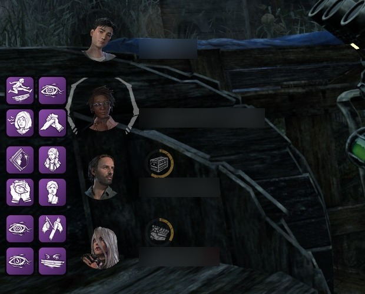
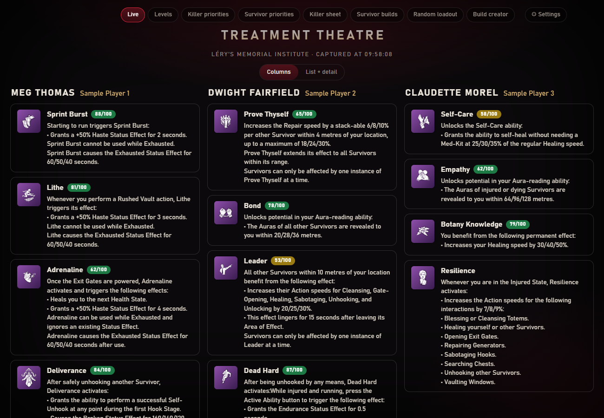

# Entity Toolkit

Un compagnon **non officiel** pour *Dead by Daylight* (Windows) : voir les perks de tes alliés par-dessus le jeu, envoyer le tableau de fin de match à NightLight avec une seule touche, suivre le niveau de tes personnages, consulter des builds recommandés et créer les tiens.

[English version](README.md)

> Aucun lien avec Behaviour Interactive, NightLight, Otzdarva ni le wiki DbD. *Dead by Daylight* et ses éléments sont des marques et la propriété de Behaviour Interactive Inc. Aucun élément du jeu, aucune note ni description n'est livré dans ce dépôt : l'outil les télécharge sur ton PC (voir [Données et vie privée](https://github.com/Tau-hub/entity-toolkit/wiki/Donnees-et-vie-privee)).

*Les quatre perks de chaque allié, en grille 2×2 à côté de son portrait dans la liste des survivants du jeu (pseudos floutés pour cette capture).*

## Ce que ça fait

| | |
|---|---|
| **Perks des alliés** (survivant) | Appuie sur la touche de capture dans le menu des joueurs (Tab) : l'outil lit les perks, les noms de personnage et les pseudos de tes trois alliés, les affiche sur la page **Live** (second écran) et les dessine sur la liste des survivants du jeu, devant le bon survivant. |
| **Texte d'une perk au survol** | Quand le jeu libère la souris (tu es accroché ou mort), passe-la sur une icône de l'overlay : une petite boîte affiche le nom, la note et le texte de la perk. Elle disparaît dès que la souris quitte l'icône. À désactiver dans la page Settings. |
| **Mode automatique** (facultatif) | Plus aucune touche : Tab lit le menu des joueurs, et le tableau de fin part tout seul une fois le match terminé pour tout le monde. Désactivé par défaut, dans Settings. |
| **Mémoire de la map** (survivant et tueur) | La même touche lit et mémorise la map depuis le menu des joueurs. |
| **Envoi NightLight** | Même touche sur le tableau de fin de match : il est envoyé à [NightLight](https://nightlight.gg) et la revue est faite pour toi (« Me » coché sur ton pseudo, les autres en Random, map réglée depuis la mémoire, Confirm cliqué). |
| **Suivi des niveaux** | Une page pour régler où tu en es avec chaque tueur et survivant, tenue à jour automatiquement depuis le tableau de fin. Les actions en masse demandent confirmation et peuvent être annulées. |
| **Priorités** | Quels personnages monter en priorité, d'après l'avis d'Otzdarva et les stats NightLight. La page affiche aussi les points de sang qui restent à dépenser pour amener tes killers, tes survivants, ou les deux, au niveau 3 (estimation d'environ 1 116 000 par niveau). |
| **Builds recommandés** | Fiches tueur (builds, tier list des add-ons, combos) et builds survivants, d'Otzdarva et de NightLight. |
| **Shrine of Secrets** | Les pages de priorités affichent les quatre perks du Shrine de la semaine et te disent lesquelles tu n'as pas encore et valent tes éclats. |
| **Loadout aléatoire** | Tire un loadout aléatoire de tueur (ou de survivant) : pouvoir, add-ons, perks, offrande en option, avec les notes. Filtres : seulement ce que tu as, une perk d'un type donné, une note minimale. L'affiche se copie ou se télécharge en image. |
| **Défi du jour** | Un loadout de tueur et un loadout de survivant par jour, les mêmes pour tout le monde : joue-le, coche-le, garde ta série. |
| **Création de build** | Enregistre tes propres builds killer et survivant (quatre perks, un nom, les killers concernés). Recherche de perks par nom, killer ou type : « aura », « gen regression », « healing »… |
| **Mise à jour de la base** | Un bouton télécharge tout depuis les sites communautaires, indique l'étape en cours et ce que le patch a apporté (nouveaux killers, survivants, perks, add-ons, maps…). Elle se rafraîchit aussi toute seule tous les 7 jours en arrière-plan (modifiable). |
| **Sons** | Un son doux « ok » ou « pas ok » pour savoir sans regarder si la map et les perks ont été lus. |

*Les captures de ce README ont été prises sur un dossier de données de démonstration : niveaux et builds inventés, pseudos d'exemple.*

*(L'interface des pages est en anglais.)*

## Comment ça marche, et ce que ça ne fait pas

- L'outil **ne regarde que les pixels** : une capture de l'écran sur lequel est le jeu, comme OBS. Il **ne lit pas** la mémoire du jeu, n'injecte rien et ne s'accroche pas au jeu.
- Le texte est lu avec l'**OCR intégré à Windows** ; les icônes de perks sont reconnues en les comparant aux icônes officielles qu'il télécharge.
- L'overlay est une **fenêtre transparente séparée** posée par-dessus le jeu (les clics la traversent, elle ne prend jamais le focus), et non quelque chose dessiné dans le jeu.
- **Aucune garantie côté anti-triche.** Il se comporte comme les outils de capture d'écran et l'overlay de Discord, mais c'est à toi de décider si tu es à l'aise avec un programme lancé à côté d'un jeu en ligne. À tes risques.

## En match, en quatre étapes

1. **Menu Tab, appuie sur la touche** (Alt + pavé numérique 7 par défaut) : l'outil lit les perks de tes trois alliés et la map.
2. **Ferme le menu** : les quatre perks de chaque allié restent affichées à côté de son portrait, pendant tout le match. Alt + pavé numérique 8 les retire.
3. **Tableau de fin, même touche** : le match est envoyé à NightLight.
4. **Rien d'autre à faire** : le match est validé sur NightLight à ta place (ta ligne cochée, la map renseignée).

Avec le **mode automatique** (Settings), les étapes 1 et 3 ne demandent aucune touche : appuie sur Tab comme d'habitude et le reste se fait tout seul ([comment ça marche](https://github.com/Tau-hub/entity-toolkit/wiki/En-match#mode-automatique)).

Les mêmes étapes avec des captures : [En match](https://github.com/Tau-hub/entity-toolkit/wiki/En-match).

## Installation

Windows 10 ou 11, le jeu en **anglais** et en mode **fenêtré ou fenêtré sans bordure**. Deux façons, le même outil :

- **Le `.exe`, sans Python.** Télécharge le zip de la [dernière release](https://github.com/Tau-hub/entity-toolkit/releases/latest), dézippe-le, double-clique sur `EntityToolkit.exe`.
- **Avec Python 3.10+.** `git clone https://github.com/Tau-hub/entity-toolkit`, puis `install.bat` et `run.bat`.

La page **Setup** s'ouvre toute seule et te guide pour le reste. Les détails, comment vérifier l'empreinte SHA-256 du téléchargement et quoi faire de l'avertissement Windows SmartScreen : [Installer](https://github.com/Tau-hub/entity-toolkit/wiki/Installer).

## Documentation

Le mode d'emploi est sur le [wiki](https://github.com/Tau-hub/entity-toolkit/wiki/Accueil) :

| Page | Ce que tu y trouves |
|---|---|
| [Installer](https://github.com/Tau-hub/entity-toolkit/wiki/Installer) | Prérequis, le `.exe` ou Python, vérifier le téléchargement, avertissements de Windows |
| [Configuration](https://github.com/Tau-hub/entity-toolkit/wiki/Configuration) | La checklist du premier lancement, toutes les options, l'icône de la zone de notification |
| [En match](https://github.com/Tau-hub/entity-toolkit/wiki/En-match) | Pas à pas avec captures : perks des alliés, overlay, envoi NightLight |
| [Niveaux et priorités](https://github.com/Tau-hub/entity-toolkit/wiki/Niveaux-et-priorites) | Suivre tes niveaux, qui monter en priorité, l'alerte Shrine of Secrets |
| [Builds et loadouts](https://github.com/Tau-hub/entity-toolkit/wiki/Builds-et-loadouts) | Builds recommandés, loadout aléatoire et ses filtres, défi du jour, création de build |
| [Données et vie privée](https://github.com/Tau-hub/entity-toolkit/wiki/Donnees-et-vie-privee) | Ce qui est stocké, où, et ce qui passe par le réseau |
| [Dépannage](https://github.com/Tau-hub/entity-toolkit/wiki/Depannage) | Écran non reconnu, mauvaises perks, overlay décalé, revue NightLight |
| [Ligne de commande et développement](https://github.com/Tau-hub/entity-toolkit/wiki/Ligne-de-commande-et-developpement) | Commandes, tests, modules, comment une version est publiée |

## Crédits

Les builds, les valeurs de perks et la tier list des add-ons viennent d'**Otzdarva** ([otzdarva-builds.com](https://otzdarva-builds.com), [otzdarva.com](https://otzdarva.com)) ; les statistiques de la communauté et l'API d'envoi de **[NightLight](https://nightlight.gg)** ; les données de perks et de maps du **[wiki Dead by Daylight](https://deadbydaylight.wiki.gg)**. Rien n'est redistribué ici : tout est récupéré sur ta machine, et les notes et avis appartiennent à leurs auteurs.

## Licence

[MIT](LICENSE) pour le code de ce dépôt. Elle ne couvre ni les données tierces téléchargées par l'outil, ni les éléments de *Dead by Daylight*.

## Assistance de l'IA

L'essentiel du code et de la documentation de ce projet a été écrit avec Claude (Anthropic) via Claude Code, à partir des besoins du mainteneur. Le mainteneur a choisi les fonctionnalités, relu les résultats et vérifié l'outil sur de vraies captures de jeu et en match. Comme pour tout code assisté par IA, il reste probablement des bugs et des configurations non gérées : lis ce que fait l'outil avant de lui donner accès à ton compte NightLight. Les commits contenant des changements écrits par l'IA portent une ligne `Co-Authored-By: Claude`. Les contributions sont bienvenues ; si un outil d'IA en a écrit une partie, dis-le dans la pull request.
