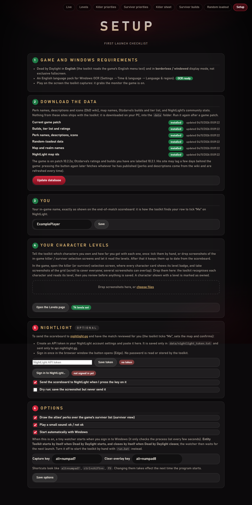
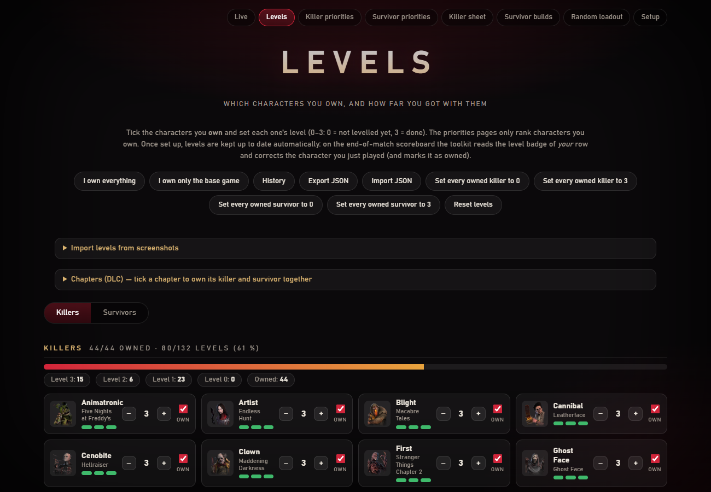
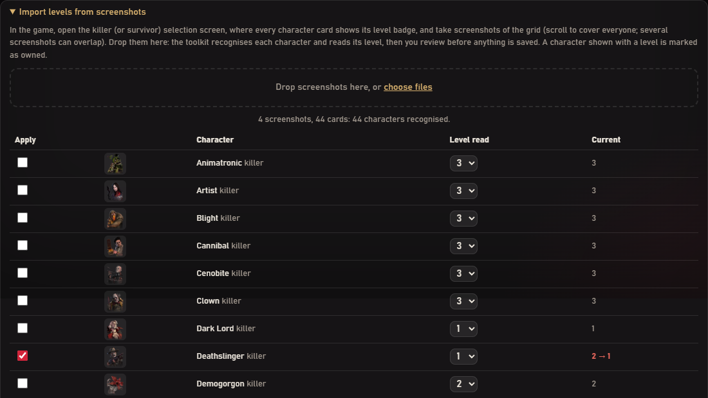
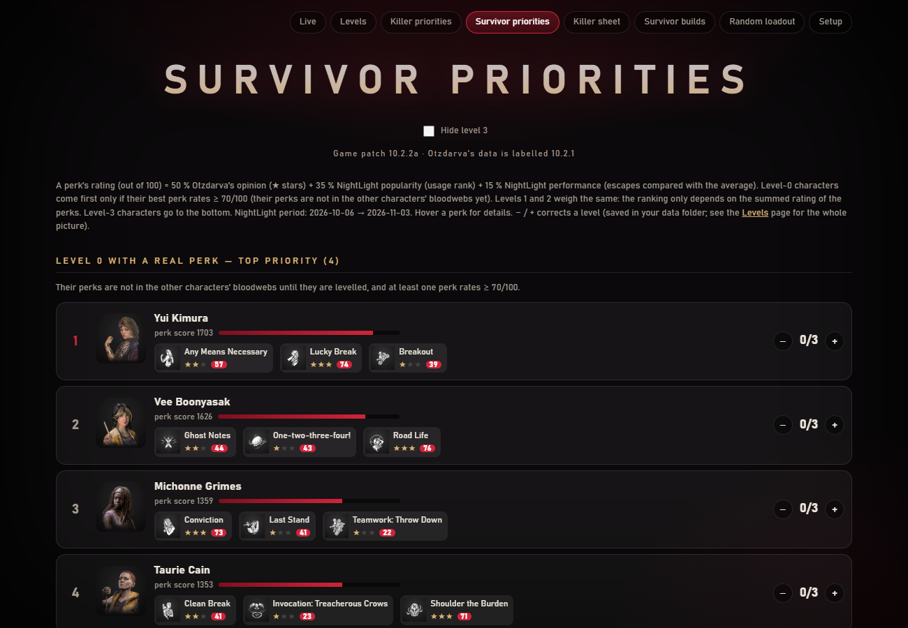
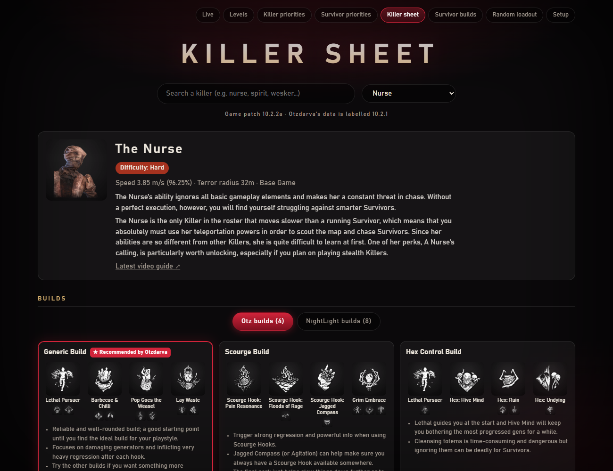
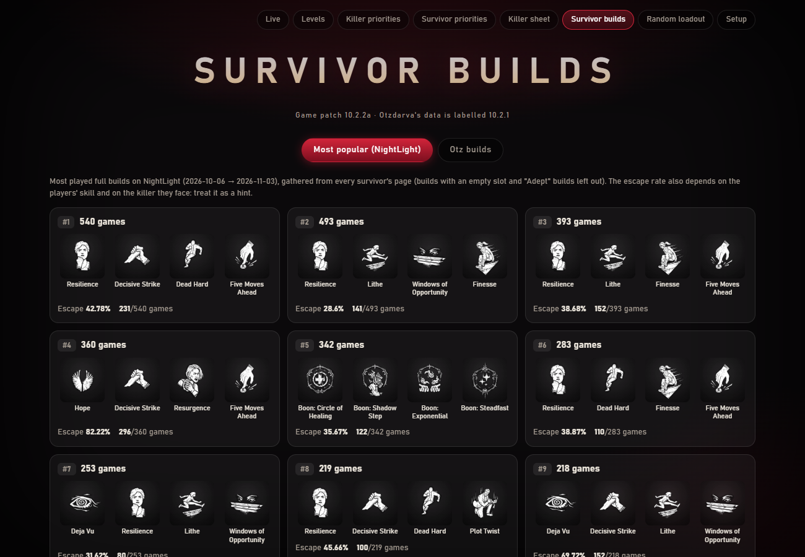
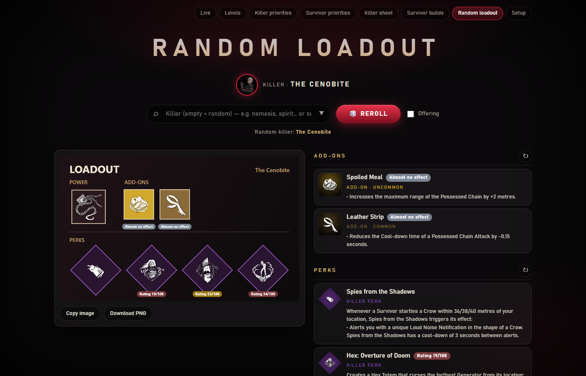

# Entity Toolkit

Un compagnon **non officiel** pour *Dead by Daylight* (Windows) : voir les perks de tes alliés par-dessus le jeu, envoyer le tableau de fin de match à NightLight avec une seule touche, suivre le niveau de tes personnages et consulter des builds recommandés.

[English version](README.md)

> Aucun lien avec Behaviour Interactive, NightLight, Otzdarva ni le wiki DbD. *Dead by Daylight* et ses éléments sont des marques et la propriété de Behaviour Interactive Inc. Aucun élément du jeu, aucune note ni description n'est livré dans ce dépôt : l'outil les télécharge sur ton PC (voir [Données et vie privée](#données-et-vie-privée)).


*Les quatre perks de chaque allié, en grille 2×2 à côté de son portrait dans la liste des survivants du jeu (pseudos floutés pour cette capture).*

## Ce que ça fait

| | |
|---|---|
| **Perks des alliés** (survivant) | Appuie sur la touche de capture dans le menu des joueurs (Tab) : l'outil lit les perks, les noms de personnage et les pseudos de tes trois alliés, les affiche sur la page **Live** (second écran) et les dessine sur la liste des survivants du jeu, devant le bon survivant. |
| **Mémoire de la map** (survivant et tueur) | La même touche lit et mémorise la map depuis le menu des joueurs. |
| **Envoi NightLight** | Même touche sur le tableau de fin de match : il est envoyé à [NightLight](https://nightlight.gg) et la revue est faite pour toi (« Me » coché sur ton pseudo, les autres en Random, map réglée depuis la mémoire, Confirm cliqué). |
| **Suivi des niveaux** | Une page pour régler où tu en es avec chaque tueur et survivant, tenue à jour automatiquement depuis le tableau de fin. |
| **Priorités** | Quels personnages monter en priorité, d'après l'avis d'Otzdarva et les stats NightLight. |
| **Builds recommandés** | Fiches tueur (builds, tier list des add-ons, combos) et builds survivants, d'Otzdarva et de NightLight. |
| **Loadout aléatoire** | Tire un loadout aléatoire de tueur (ou de survivant) : pouvoir, add-ons, perks, offrande en option, avec les notes. L'affiche se copie ou se télécharge en image. |
| **Sons** | Un son doux « ok » ou « pas ok » pour savoir sans regarder si la map et les perks ont été lus. |


*(L'interface des pages est en anglais.)*

## Comment ça marche, et ce que ça ne fait pas

- L'outil **ne regarde que les pixels** : une capture de l'écran sur lequel est le jeu, comme OBS. Il **ne lit pas** la mémoire du jeu, n'injecte rien et ne s'accroche pas au jeu.
- Le texte est lu avec l'**OCR intégré à Windows** ; les icônes de perks sont reconnues en les comparant aux icônes officielles qu'il télécharge.
- L'overlay est une **fenêtre transparente séparée** posée par-dessus le jeu (les clics la traversent, elle ne prend jamais le focus), et non quelque chose dessiné dans le jeu.
- **Aucune garantie côté anti-triche.** Il se comporte comme les outils de capture d'écran et l'overlay de Discord, mais c'est à toi de décider si tu es à l'aise avec un programme lancé à côté d'un jeu en ligne. À tes risques.

## Prérequis

- Windows 10 ou 11, **Python 3.10 ou plus récent**, Microsoft Edge (utilisé pour la revue NightLight).
- *Dead by Daylight* en **anglais**, en mode **sans bordure ou fenêtré** (pas en plein écran exclusif).
- Un **pack de langue anglais** pour l'OCR de Windows : Paramètres → Heure et langue → Langue et région.
- Testé en **2560×1440** pour le jeu et en **1920×1080** pour les écrans annexes. Toutes les positions sont proportionnelles à la hauteur de l'écran du jeu, mais les autres résolutions n'ont pas été testées : voir [Dépannage](#dépannage).

## Installation

```bash
git clone https://github.com/Tau-hub/entity-toolkit
cd entity-toolkit
install.bat
run.bat
```

`install.bat` installe les paquets Python. `run.bat` lance l'outil en arrière-plan et ouvre la page **Setup** la première fois.

## Premier lancement : la page Setup



1. **Prérequis.** La page vérifie que Windows a un moteur OCR anglais.
2. **Update database.** Un bouton télécharge les noms, descriptions et icônes des perks (wiki DbD), les noms de maps, les builds et la tier list d'Otzdarva, et les stats de NightLight. La première fois, compte quelques minutes. Relance-le après un patch du jeu (nouveaux perks, nouvelles maps, nouvelles notes). La page indique le patch du jeu (d'après les annonces Steam) et l'étiquette de patch des données d'Otzdarva, qui peut avoir quelques jours de retard ; les pages du wiki sont retéléchargées à chaque mise à jour. Chaque étape rend compte séparément, donc un site en panne ne bloque pas les autres. Depuis une console : `python -m entity_toolkit update-db`.
3. **You.** Saisis ton pseudo en jeu exactement comme sur le tableau de fin.
4. **Your levels.** Dépose des captures des écrans de sélection des tueurs et des survivants directement dans la page Setup : l'outil lit quels personnages tu as et leurs niveaux (tu vérifies avant d'enregistrer), ou règle-les à la main sur la page **Levels** (voir plus bas).
5. **NightLight** (facultatif). Colle un jeton d'API créé dans les paramètres de ton compte NightLight et connecte-toi une fois dans la fenêtre Edge qu'ouvre le bouton. L'outil ne voit jamais ton mot de passe.
6. **Options.** Overlay oui/non, sons, simulation (enregistre le tableau mais ne l'envoie jamais) et les touches.

## En match

La touche par défaut est **Alt + pavé numérique 7** (verrouillage numérique activé). Elle ne réagit que si le jeu est lancé **et** au premier plan.

| Tu es sur… | Appuie une fois | Résultat |
|---|---|---|
| Le **menu des joueurs** (Tab), en survivant | oui | Map mémorisée, perks des alliés sur la page Live, overlay dessiné quand tu refermes le menu |
| Le **menu des joueurs**, en tueur | oui | Map mémorisée |
| Le jeu (menu fermé), overlay affiché | oui | Overlay retiré |
| Le jeu (menu fermé), overlay retiré | oui | Overlay remis avec les derniers perks lus |
| Le **tableau de fin** | oui | Capture envoyée à NightLight, match revu et validé, niveau de ton personnage corrigé |
| Tout autre écran | oui | Son « pas ok », rien n'est envoyé |

**Alt + pavé numérique 8** retire l'overlay et oublie les perks (pratique si tu ne veux pas envoyer ce match). Les deux touches se changent dans la page Setup.

L'outil s'arrête tout seul quand le jeu se ferme. Pour qu'il démarre tout seul quand le jeu démarre : `python -m entity_toolkit autostart install` (annuler avec `autostart remove`).

Pourquoi l'overlay attend : la liste des survivants du jeu n'est visible qu'une fois le menu Tab refermé. Après l'appui, l'outil surveille l'écran, lit les noms de la liste du jeu et associe chaque allié à la bonne ligne, d'abord par **portrait**, puis par **pseudo** quand deux alliés jouent le même personnage ou que les portraits se ressemblent trop. Ta propre ligne ne bouge jamais.

## Niveaux





*Dépôt de quatre captures de l'écran de sélection des tueurs : chaque personnage est reconnu, et les cinq niveaux qui diffèrent de ceux enregistrés sont cochés pour que tu les appliques.*

Les niveaux vont de 0 à 3 (0 = pas encore monté, 3 = terminé). Un nouvel utilisateur les règle une fois sur la page **Levels**, soit à la main, soit en **déposant des captures des écrans de sélection des tueurs et des survivants** : l'outil reconnaît chaque carte de personnage (correspondance de points d'intérêt SIFT avec les portraits téléchargés) et lit sa pastille de niveau, puis te montre ce qu'il a trouvé pour que tu vérifies et appliques. À la main : **+** et **−** par personnage, boutons pour mettre tous les tueurs ou tous les survivants à 0 ou à 3, **Import / Export JSON** pour déplacer tes niveaux d'un PC à l'autre ou les partager, et un panneau **History**. Ensuite l'outil les tient à jour tout seul : sur le tableau de fin, il lit la pastille de niveau de *ta* ligne et corrige le personnage que tu viens de jouer. Tout le monde ne possède pas tous les personnages : chacun a donc une case **Own**. Boutons **I own everything** et **I own only the base game** (puis tu coches ce que tu as), panneau **Chapters (DLC)** qui coche ensemble le tueur et le survivant d'un même chapitre, ou un par un. Les priorités ne classent que les personnages que tu possèdes, et jouer un personnage sur le tableau de fin le marque comme possédé.



## Builds recommandés



La page **Killer sheet** montre les builds d'Otzdarva, les builds les plus joués sur NightLight, la tier list des add-ons et les combos d'add-ons de chaque tueur. **Survivor builds** montre les builds NightLight les plus populaires et les builds survivants d'Otzdarva. 

Tout vient de la base que tu as téléchargée : c'est aussi frais que ta dernière mise à jour.

## Loadout aléatoire



Tire un loadout aléatoire de tueur (ou de survivant) : pouvoir, add-ons, quatre perks et une offrande en option, chacun avec sa note. Relance tout ou une partie, puis copie l'affiche ou télécharge-la en PNG.

## Données et vie privée

Tout ce que l'outil enregistre vit dans le dossier `data/` (ignoré par git) à côté du code (modifiable avec la variable d'environnement `ENTITY_TOOLKIT_DATA`) :

| Fichier / dossier | Contenu |
|---|---|
| `icons/`, `images/`, `loadout_data.json`, `loadout_extra.json`, `patch.json`, `killers.json`, `survivors.json`, `survivor_builds.json`, `maps.json`, `nl_maps.json` | Téléchargés par **Update database** |
| `levels.json`, `levels_history.json`, `owned.json` | Tes niveaux, et les personnages que tu ne possèdes pas |
| `config.json` | Tes réglages |
| `nightlight_token.txt` | Ton jeton d'API NightLight. Envoyé **uniquement** à `api.nightlight.gg` |
| `nightlight_profile/` | Le profil Edge qui garde ta session NightLight |
| `uploads/`, `debug/` | Les tableaux envoyés et les dernières captures gardées pour diagnostiquer |
| `entity_toolkit.log` | Ce que l'outil a fait |

Réseau : la capture du jeu ne quitte jamais ton PC, sauf le **tableau de fin**, qui part vers NightLight quand tu appuies sur la touche dessus (désactive-le avec *Dry run* dans Setup). **Update database** lit `deadbydaylight.wiki.gg`, `otzdarva-builds.com`, `otzdarva.com`, `otz-addon-tierlist.pages.dev` et `nightlight.gg`. Le serveur web local n'écoute que sur `127.0.0.1` et refuse les requêtes venant d'autres sites.

## Dépannage

- **« Screen not recognised »** : l'outil cherche les mots *PLAYERS / QUESTS* (menu des joueurs) ou *MATCH SCOREBOARD* en haut à gauche. Vérifie que le jeu est en anglais et que tu as appuyé sur l'un de ces deux écrans. La capture est gardée dans `data/debug/` (`*_unknown.jpg`).
- **Rien ne se passe** : le jeu doit être lancé et au premier plan. Regarde `data/entity_toolkit.log`. Lance `python -m entity_toolkit` à la place de `run.bat` pour voir la console.
- **Perks faux ou manquants** : les perks sous 78 % de confiance sont marqués « to check » sur la page Live. Lance **Update database** après un patch pour que les nouvelles icônes existent.
- **Overlay mal placé** : les positions sont proportionnelles à la hauteur de l'écran du jeu et ont été mesurées en 2560×1440. Ajuste `data/overlay_layout.json` (`x`, `dy`, `rows`, `size`, `gap`, décrits en tête de `entity_toolkit/overlay.py`) et rappuie sur la touche. Les pull requests avec des mesures pour d'autres résolutions sont très bienvenues.
- **La revue NightLight échoue** : Edge doit être installé et tu dois t'être connecté une fois (Setup → Sign in). La fenêtre est visible exprès : NightLight est derrière Cloudflare, qui refuse les navigateurs invisibles. L'outil rend le focus au jeu pendant qu'il travaille.
- **Les noms de la liste du jeu sont illisibles** : l'overlay se rabat alors sur l'ordre du menu.

## Ligne de commande

```text
python -m entity_toolkit                  démarrer (comme run.bat)
python -m entity_toolkit update-db        télécharger / rafraîchir les données  [--only patch builds perks loadout maps nl_maps] [--refresh]
python -m entity_toolkit login            se connecter à NightLight
python -m entity_toolkit autostart install   démarrer tout seul avec le jeu (autostart remove pour annuler)
python -m entity_toolkit test-image X.jpg analyser une capture comme si tu avais appuyé sur la touche (simulation)
python -m entity_toolkit serve --demo     servir les pages avec un résultat inventé, sans le jeu
```

## Développement

```bash
python -m unittest discover -s tests
```

| Module | Rôle |
|---|---|
| `assistant.py` | La boucle de la touche : quel écran, que faire |
| `recognize.py`, `analyzer.py` | Perks, noms et map d'après une capture du menu des joueurs |
| `overlay.py` | La fenêtre transparente et l'association allié → ligne |
| `nightlight.py`, `review.py` | Envoi, mémoire de la map, revue automatique |
| `levels.py` | Niveaux, historique, lecture de la pastille du tableau de fin |
| `database/` | `update-db` : téléchargements du wiki, d'Otzdarva et de NightLight |
| `server.py`, `web/` | Pages locales et API JSON |

Contributions : ouvre d'abord une issue pour tout ce qui est gros (voir aussi [Assistance de l'IA](#assistance-de-lia)).

## Crédits

Les builds, les valeurs de perks et la tier list des add-ons viennent d'**Otzdarva** ([otzdarva-builds.com](https://otzdarva-builds.com), [otzdarva.com](https://otzdarva.com)) ; les statistiques de la communauté et l'API d'envoi de **[NightLight](https://nightlight.gg)** ; les données de perks et de maps du **[wiki Dead by Daylight](https://deadbydaylight.wiki.gg)**. Rien n'est redistribué ici : tout est récupéré sur ta machine, et les notes et avis appartiennent à leurs auteurs.

## Licence

[MIT](LICENSE) pour le code de ce dépôt. Elle ne couvre ni les données tierces téléchargées par l'outil, ni les éléments de *Dead by Daylight*.

## Assistance de l'IA

L'essentiel du code et de la documentation de ce projet a été écrit avec Claude (Anthropic) via Claude Code, à partir des besoins du mainteneur. Le mainteneur a choisi les fonctionnalités, relu les résultats et vérifié l'outil sur de vraies captures de jeu et en match. Comme pour tout code assisté par IA, il reste probablement des bugs et des configurations non gérées : lis ce que fait l'outil avant de lui donner accès à ton compte NightLight. Les commits contenant des changements écrits par l'IA portent une ligne `Co-Authored-By: Claude`. Les contributions sont bienvenues ; si un outil d'IA en a écrit une partie, dis-le dans la pull request.
