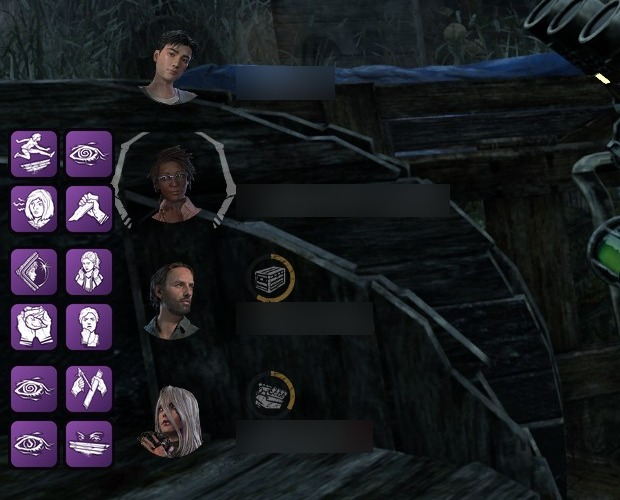
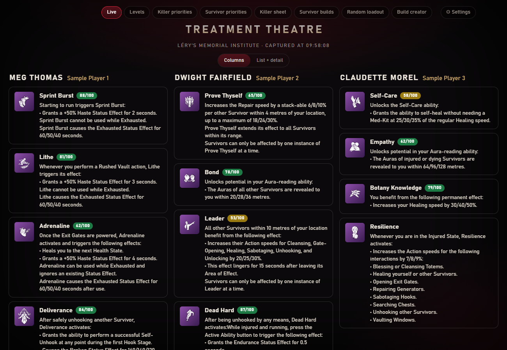

# Entity Toolkit

[Version française](README.fr.md)

An **unofficial** companion for *Dead by Daylight* (Windows): see your teammates' perks over the game, send your match scoreboard to NightLight with one key, track your character levels, browse recommended builds, and build your own.

> Not affiliated with Behaviour Interactive, NightLight, Otzdarva or the DbD wiki. *Dead by Daylight* and its assets are trademarks / property of Behaviour Interactive Inc. The perk icons, descriptions, builds and ratings the toolkit needs come with it in the [`seed/`](seed/README.md) folder, which names the source and owner of each part: they are not covered by this project's licence, and are then kept current on your PC.

*Each ally's four perks, drawn in a 2×2 grid next to their portrait in the game's own survivor list (player names blurred for this screenshot).*

## What it does

| | |
|---|---|
| **Allies' perks** (survivor) | On the Tab players menu (with your capture key, or by itself in automatic mode), the toolkit reads your three allies' perks, character names and player names, shows them on the **Live** page (second screen) and draws them over the game's survivor list, on the right survivor. |
| **Perk text on hover** | When the game frees the mouse (you are hooked or dead), put it on an overlay icon and a small box shows that perk's name, rating and text. It disappears as soon as the mouse leaves the icon. Turn it off in the Settings page. |
| **Automatic mode** (the default) | No key at all: Tab (menu open about one second) reads the players menu, and the scoreboard is sent by itself once the match is over for everyone. Prefer a key? Choose *Hotkey* in Settings. |
| **Map memory** (survivor and killer) | The map is read from the players menu at the same time, and remembered for the upload. |
| **NightLight upload** | On the end-of-match scoreboard (same key, or by itself in automatic mode), the match is sent to [NightLight](https://nightlight.gg), the match is reviewed for you ("Me" ticked on your name, everyone else Random, map set from memory, Confirm clicked). |
| **Level tracking** | A page to set how far you got with each killer and survivor, kept up to date automatically from the scoreboard. Bulk changes ask for confirmation and can be undone. |
| **Priorities** | Which characters are worth levelling next, from Otzdarva's opinion plus NightLight stats. The page also shows the bloodpoints still needed to bring your owned killers, survivors, or both to level 3 (an estimate of about 1,116,000 per level). |
| **Recommended builds** | Killer sheets (builds, add-on tier list, combos) and survivor builds, from Otzdarva and NightLight. |
| **Shrine of Secrets** | The priorities pages show this week's four Shrine perks and tell you which ones you do not have yet and are worth your shards. |
| **Random loadout** | Roll a random killer (or survivor) loadout: power, add-ons, perks, optional offering, with ratings. Filters: only what you have, one perk of a given type, a minimum rating. Copy or download the poster as an image. |
| **Daily challenge** | One killer loadout and one survivor loadout per day, the same for everyone: play it, tick it, keep your streak. |
| **Build creator** | Save your own killer and survivor builds (four perks, a name, the killers it suits). Search perks by name, killer or type: "aura", "gen regression", "healing"… |
| **Ready after installing** | The perks, icons, maps, builds and ratings come with the toolkit. At each start it checks whether the game got a new patch and refreshes them by itself (only the new icons are downloaded); it also does so every 7 days. All of it can be changed. |
| **Updates itself** | When a newer Entity Toolkit is released, it offers to install it: one click, the download is checked (SHA-256), your data is kept, the toolkit restarts. |
| **Sounds** | A soft "ok" or "not ok" sound so you know without looking whether the map and perks were read. |

*The screenshots in this README were taken on a demo data folder: made-up levels and builds, sample player names.*

## How it works, and what it does not do

- It **only looks at pixels**: a screenshot of the monitor the game is on, like OBS does. It does **not** read the game's memory, inject anything, or hook the game.
- Text is read with the **OCR built into Windows**; perk icons are recognised by comparing them with the official icons it downloads.
- The overlay is a **separate transparent window** laid over the game (click-through, never takes focus), not something drawn inside the game.
- **No guarantee about anti-cheat.** It behaves like screen-capture tools and Discord's overlay, but only you decide whether you are comfortable running anything next to an online game. Use it at your own risk.

## In a match

The toolkit acts at two moments, the start and the end of a match. You choose in Settings how they are triggered: **Automatic** (the default: no key at all) or **Hotkey** (a capture key of your choice, Alt + Numpad 7 until you change it).

| | Automatic mode (default) | Hotkey mode |
|---|---|---|
| **Start of the match** | Open the players menu (Tab) and keep it open about one second | Open the players menu (Tab) and press your capture key |
| **End of the match** | Nothing: it is sent once every player's perks are revealed | Press your capture key on the scoreboard |

1. **Start: the players menu is read.** Your three allies' perks and the map.
2. **Close the menu**: each ally's four perks stay drawn next to their portrait, for the whole match. Your clear key (Alt + Numpad 8 until you change it) removes them.
3. **End: the scoreboard is read** and, if you set NightLight up, sent to it.
4. **Nothing else to do**: the match is reviewed on NightLight for you (your row ticked, the map set).

How the automatic mode works, what it costs and its limits: [Automatic mode](https://github.com/Tau-hub/entity-toolkit/wiki/In-a-match#automatic-mode).

The same steps with screenshots: [In a match](https://github.com/Tau-hub/entity-toolkit/wiki/In-a-match).

## Install

Windows 10 or 11, the game in **English** and in **borderless or windowed** mode. Two ways, same tool:

- **The `.exe`, no Python needed.** Download the zip from the [latest release](https://github.com/Tau-hub/entity-toolkit/releases/latest), unzip it, double-click `EntityToolkit.exe`.
- **With Python 3.10+.** `git clone https://github.com/Tau-hub/entity-toolkit`, then `install.bat` and `run.bat`.

Entity Toolkit opens **its own window** (no browser, no address to type) on the **Setup** page, which walks you through the rest. Details, how to check the download's SHA-256 and what to do about the Windows SmartScreen warning: [Installation](https://github.com/Tau-hub/entity-toolkit/wiki/Installation).

## Documentation

The manual is on the [wiki](https://github.com/Tau-hub/entity-toolkit/wiki):

| Page | What you will find |
|---|---|
| [Installation](https://github.com/Tau-hub/entity-toolkit/wiki/Installation) | Requirements, the `.exe` or Python, checking your download, Windows warnings |
| [Setup and settings](https://github.com/Tau-hub/entity-toolkit/wiki/Setup-and-settings) | The first-launch setup page by page, hotkey or automatic mode, every option, the notification-area icon |
| [In a match](https://github.com/Tau-hub/entity-toolkit/wiki/In-a-match) | Step by step with screenshots, in hotkey mode and in automatic mode: allies' perks, the overlay, the NightLight upload |
| [Levels and priorities](https://github.com/Tau-hub/entity-toolkit/wiki/Levels-and-priorities) | Tracking your levels, who to level next, the Shrine of Secrets alert |
| [Builds and loadouts](https://github.com/Tau-hub/entity-toolkit/wiki/Builds-and-loadouts) | Recommended builds, random loadout and its filters, the daily challenge, the build creator |
| [Data and privacy](https://github.com/Tau-hub/entity-toolkit/wiki/Data-and-privacy) | What is stored, where, and what goes over the network |
| [Troubleshooting](https://github.com/Tau-hub/entity-toolkit/wiki/Troubleshooting) | Nothing happens, a missing ally or perk, scoreboard not sent, misplaced overlay, NightLight review |
| [Command line and development](https://github.com/Tau-hub/entity-toolkit/wiki/Command-line-and-development) | Commands, tests, modules, how a release is made |

## Credits

Builds, perk values and the add-on tier list come from **Otzdarva** ([otzdarva-builds.com](https://otzdarva-builds.com), [otzdarva.com](https://otzdarva.com)); community statistics and the upload API from **[NightLight](https://nightlight.gg)**; perk and map data from the **[Dead by Daylight wiki](https://deadbydaylight.wiki.gg)**. A copy of that data ships with the toolkit so that it works right after installing ([`seed/`](seed/README.md) says what comes from where); it stays the property of its authors, and it is removed on request.

## License

[MIT](LICENSE) for the code of this repository. It does not cover the third-party data the toolkit ships in [`seed/`](seed/README.md) or downloads, nor *Dead by Daylight*'s assets.

## AI assistance

Most of the code and documentation of this project was written with Claude (Anthropic) through Claude Code, from the maintainer's requirements. The maintainer chose the features, reviewed the results, and checked the tool on real game screenshots and in matches. As with any AI-assisted code, bugs and unhandled setups are likely: read what the toolkit does before giving it access to your NightLight account. Commits containing AI-written changes carry a `Co-Authored-By: Claude` line. Contributions are welcome; if an AI tool wrote part of yours, mention it in the pull request.
