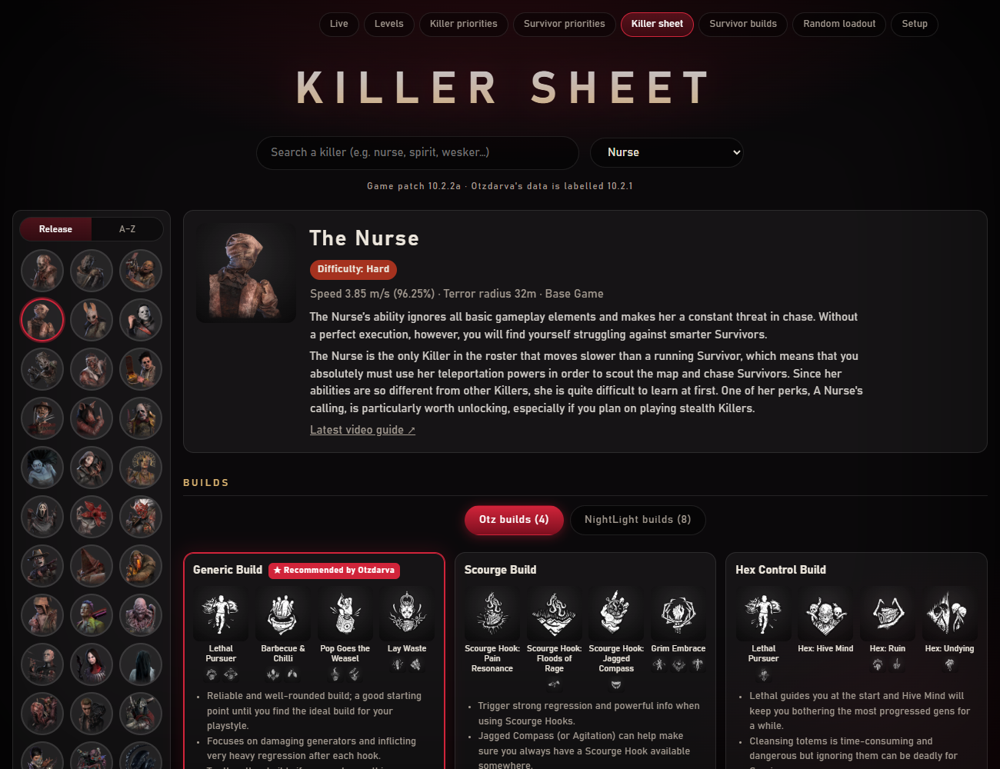
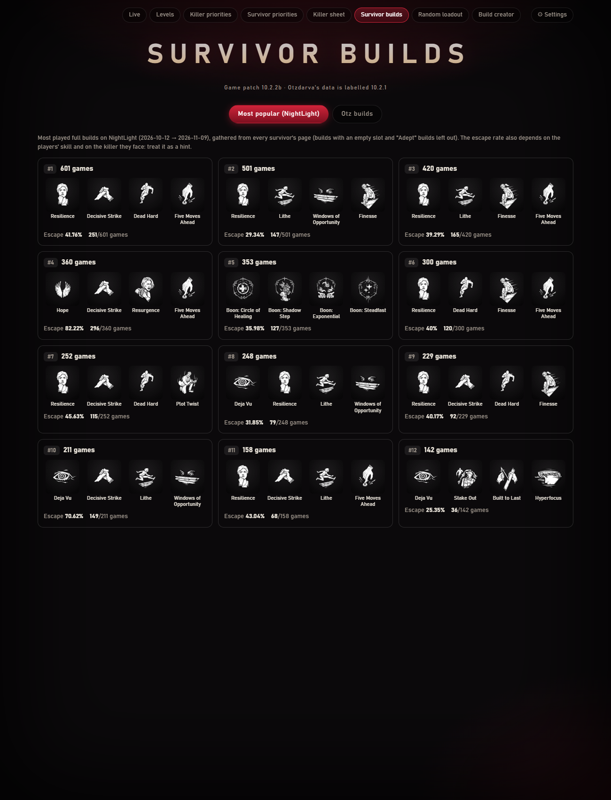
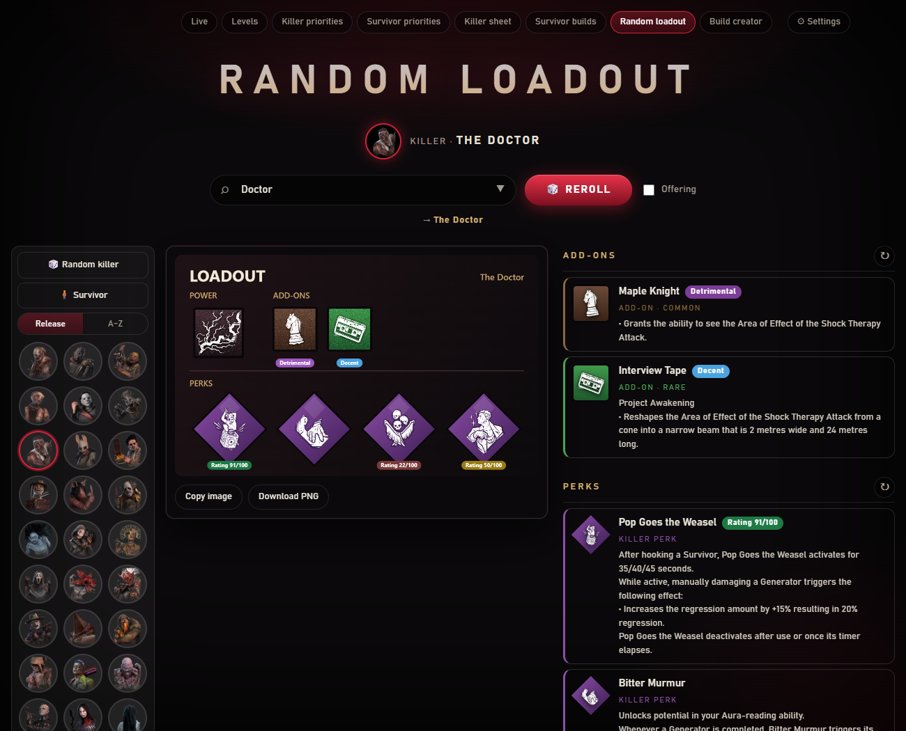
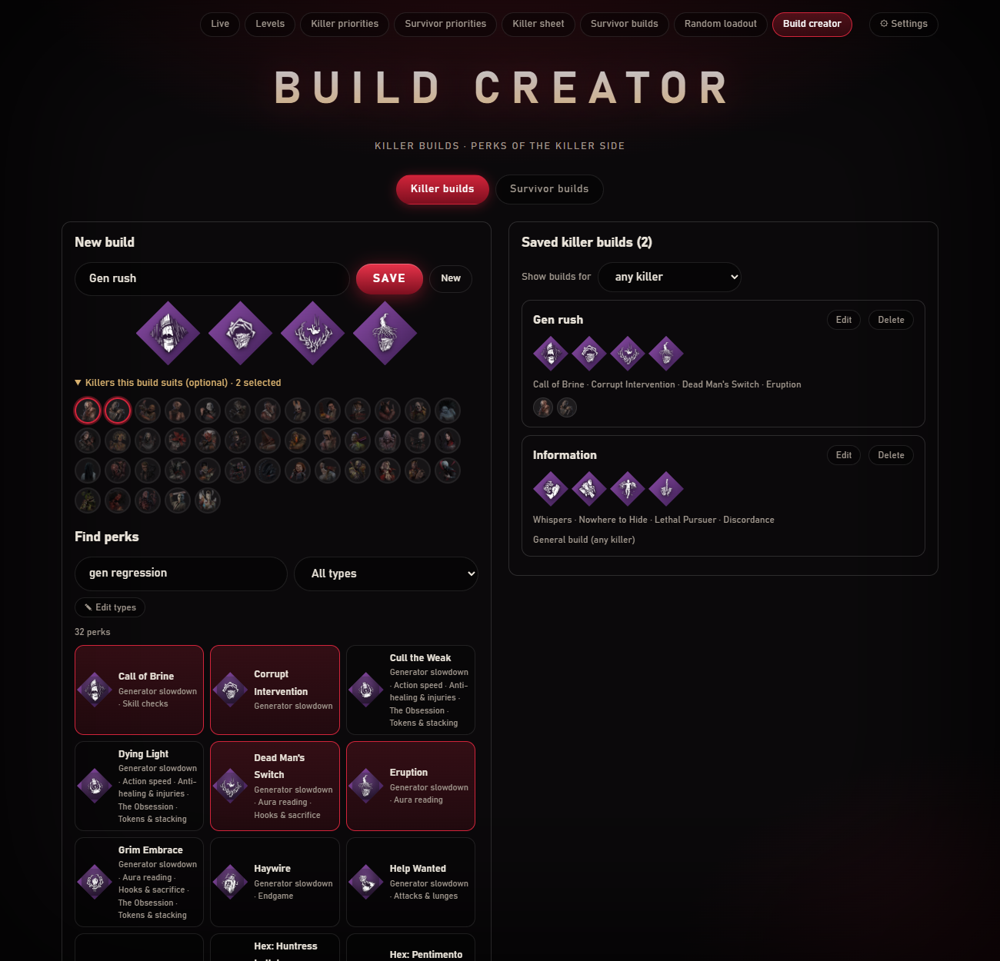

[← Home](https://github.com/Tau-hub/entity-toolkit/wiki/Home) · [Français](https://github.com/Tau-hub/entity-toolkit/wiki/Builds-et-loadouts)

## Recommended builds

The **Killer sheet** page shows Otzdarva's builds, NightLight's most played builds, the add-on tier list and add-on combos for each killer. **Survivor builds** shows the most popular NightLight builds and Otzdarva's survivor builds. 

Everything comes from the database you downloaded, so it is as fresh as your last update.

## Random loadout

Pick a killer (or a survivor, or press **Random killer**) and get a random loadout: power, add-ons, four perks and an optional offering, each with its rating. The first visit shows every killer as a portrait; once you have rolled, they move to a column on the left so you can roll another one with a click. Reroll everything or one part, then copy the poster or download it as a PNG.

**Filters.** Three options next to the Reroll button, remembered between visits:

- **Only what I have**: perks come only from the characters you have levelled on the Levels page (plus the general perks), and a random killer is one you own.
- **At least one perk of a type**: one of the four perks is always of the type you choose ("Healing", "Generator slowdown", "Aura reading"…).
- **Perks rated 35+ / 60+**: leaves out the weakest perks.

When a combination is impossible (for instance no perk you have is of that type), the page says which filter it ignored.

**Daily challenge.** **📅 Daily killer** and **📅 Daily survivor** give today's loadout: a killer with two add-ons and four perks, or an item with two add-ons and four perks. It is drawn from the date, so everyone using the toolkit gets the same one (with the same database), and it changes at midnight UTC. Press **✓ I played it** once you have done it: the button counts the days in a row. With *Only what I have* ticked, you get your own version of the day, limited to what you own. The notification-area icon has a shortcut to both challenges.

## Build creator

Choose **Killer builds** or **Survivor builds**, give the build a name, and pick up to four perks. Killer builds can list the killers they suit (shown as small heads on the saved build); a build with none is a general one. Survivor builds apply to any survivor.

To find perks, type a perk name, a killer name or a **type** ("aura", "gen regression", "healing"), or use the drop-down list of all types. A perk can have several types. The types come from the wiki's mechanic tags and from the perk text, so they are a best effort: **✎ Edit types** lets you correct any perk by hand (kept in `data/perk_types.json`). Saved builds are in `data/my_builds.json`.
