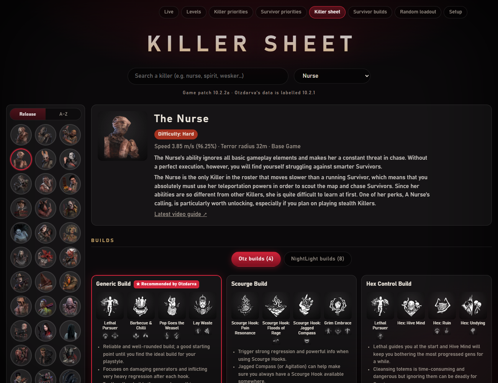
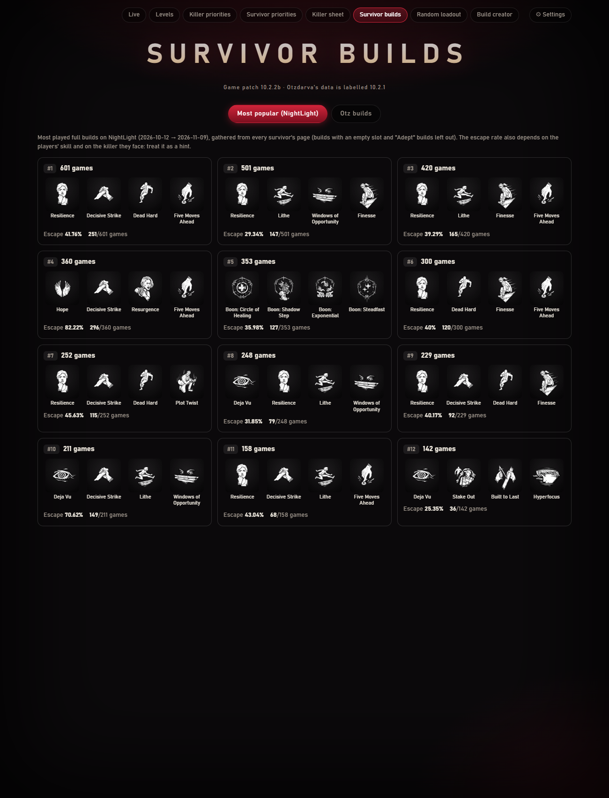
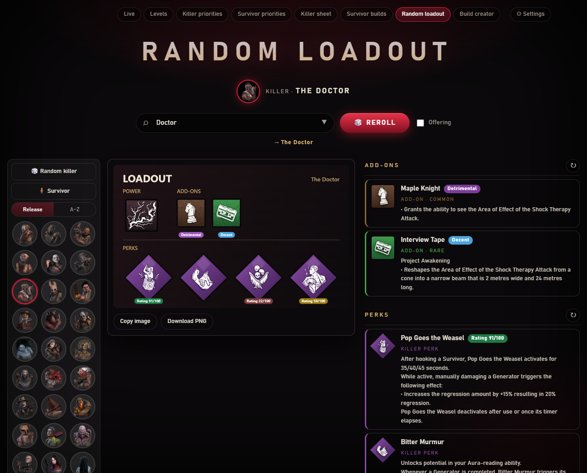
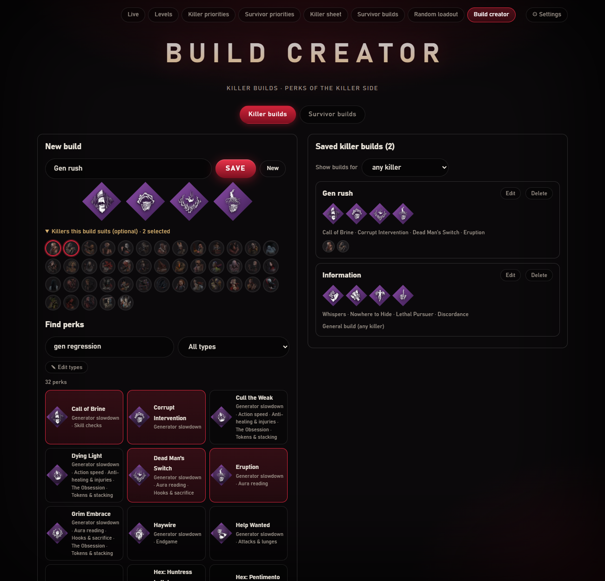

[← Accueil](https://github.com/Tau-hub/entity-toolkit/wiki/Accueil) · [English](https://github.com/Tau-hub/entity-toolkit/wiki/Builds-and-loadouts)

## Builds recommandés

La page **Killer sheet** montre les builds d'Otzdarva, les builds les plus joués sur NightLight, la tier list des add-ons et les combos d'add-ons de chaque tueur. **Survivor builds** montre les builds NightLight les plus populaires et les builds survivants d'Otzdarva. 

Tout vient de la base que tu as téléchargée : c'est aussi frais que ta dernière mise à jour.

## Loadout aléatoire

Choisis un tueur (ou un survivant, ou **Random killer**) et obtiens un loadout aléatoire : pouvoir, add-ons, quatre perks et une offrande en option, chacun avec sa note. La première visite montre tous les tueurs en portraits ; une fois le tirage fait, ils passent dans une colonne à gauche pour en tirer un autre d'un clic. Relance tout ou une partie, puis copie l'affiche ou télécharge-la en PNG.

**Filtres.** Trois options à côté du bouton Reroll, retenues d'une visite à l'autre :

- **Only what I have** : les perks viennent seulement des personnages que tu as montés sur la page Levels (plus les perks générales), et le tueur aléatoire est un tueur que tu possèdes.
- **At least one perk of a type** : une des quatre perks est toujours du type choisi (« Healing », « Generator slowdown », « Aura reading »…).
- **Perks rated 35+ / 60+** : écarte les perks les plus faibles.

Quand une combinaison est impossible (par exemple aucune perk que tu as n'est de ce type), la page dit quel filtre elle a ignoré.

**Défi du jour.** **📅 Daily killer** et **📅 Daily survivor** donnent le loadout du jour : un tueur avec deux add-ons et quatre perks, ou un objet avec deux add-ons et quatre perks. Il est tiré à partir de la date, donc tous ceux qui utilisent l'outil ont le même (avec la même base de données), et il change à minuit UTC. Appuie sur **✓ I played it** une fois joué : le bouton compte les jours d'affilée. Avec *Only what I have* coché, tu as ta propre version du jour, limitée à ce que tu possèdes. L'icône de la zone de notification a un raccourci vers les deux défis.

## Création de build

Choisis **Killer builds** ou **Survivor builds**, donne un nom au build et prends jusqu'à quatre perks. Un build killer peut indiquer les killers auxquels il convient (affichés en petites têtes sur le build enregistré) ; sans killer, c'est un build général. Les builds survivant valent pour n'importe quel survivant.

Pour trouver des perks, tape un nom de perk, un nom de killer ou un **type** (« aura », « gen regression », « healing »), ou utilise la liste déroulante de tous les types. Un perk peut avoir plusieurs types. Les types viennent des étiquettes du wiki et du texte du perk : c'est approximatif, et **✎ Edit types** te laisse corriger un perk à la main (gardé dans `data/perk_types.json`). Les builds enregistrés sont dans `data/my_builds.json`.
