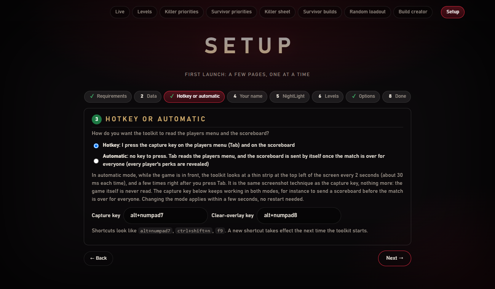
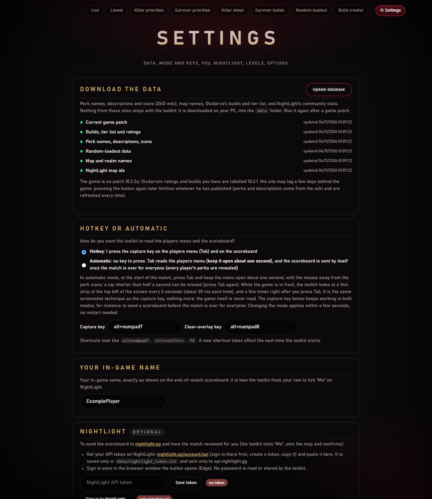

[← Accueil](https://github.com/Tau-hub/entity-toolkit/wiki/Accueil) · [English](https://github.com/Tau-hub/entity-toolkit/wiki/Setup-and-settings)

## Premier lancement : la page Setup

1. **Prérequis.** La page vérifie que Windows a un moteur OCR anglais.
2. **Update database.** Un bouton télécharge les noms, descriptions et icônes des perks (wiki DbD), les noms de maps, les builds et la tier list d'Otzdarva, et les stats de NightLight. La première fois, compte quelques minutes. Relance-le après un patch du jeu (nouveaux perks, nouvelles maps, nouvelles notes). La page indique le patch du jeu (d'après les annonces Steam) et l'étiquette de patch des données d'Otzdarva, qui peut avoir quelques jours de retard ; les pages du wiki sont retéléchargées à chaque mise à jour. Chaque étape rend compte séparément, donc un site en panne ne bloque pas les autres. Depuis une console : `python -m entity_toolkit update-db`. Pendant le téléchargement, la page indique l'étape en cours, puis ce que le patch a apporté (killers, survivants, perks, add-ons, objets, offrandes, maps ajoutés ou retirés). Une fois fait une première fois, l'outil rafraîchit les données tout seul tous les 7 jours en arrière-plan (modifiable ou désactivable dans *Options*).
3. **You.** Saisis ton pseudo en jeu exactement comme sur le tableau de fin.
4. **Your levels.** Dépose des captures des écrans de sélection des tueurs et des survivants directement dans la page Setup : l'outil lit quels personnages tu as et leurs niveaux (tu vérifies avant d'enregistrer), ou règle-les à la main sur la page **Levels** (voir plus bas).
5. **NightLight** (facultatif). Colle un jeton d'API créé dans les paramètres de ton compte NightLight et connecte-toi une fois dans la fenêtre Edge qu'ouvre le bouton. L'outil ne voit jamais ton mot de passe.
6. **Options.** Mode touche ou automatique, et les touches (voir [En match](https://github.com/Tau-hub/entity-toolkit/wiki/En-match#mode-automatique)), overlay oui/non, sons, icône dans la zone de notification, vérification d'une nouvelle version, ouverture de la page Live dans ton navigateur au démarrage de l'outil (activée par défaut : avec le démarrage automatique, la page s'ouvre à chaque lancement du jeu), simulation (enregistre le tableau mais ne l'envoie jamais) et les touches.

Chaque modification de la page est enregistrée dès que tu la fais (une petite note *Saved ✓* apparaît en bas à droite) : il n'y a pas de bouton d'enregistrement.

Quand tu appuies sur **Finish setup**, le bouton *Setup* devient **⚙ Settings** (en haut à droite) : la même page sans les prérequis, pour mettre à jour la base, changer ton pseudo, importer les niveaux, régler le jeton NightLight et les options. *Reset the setup* en bas refait apparaître la checklist de premier lancement (tes données sont gardées).

### L'icône dans la zone de notification

Tant que l'outil tourne, un petit **E** rouge reste dans la zone de notification de Windows (en bas à droite de la barre des tâches, derrière la flèche **^** si Windows le masque). Il indique que l'outil est allumé, et c'est le moyen le plus rapide de retrouver les pages quand l'onglet du navigateur est fermé :

- **Double-clic** : ouvre la page Live.
- **Clic droit** : un menu avec toutes les pages (Live, Levels, Killer priorities, Survivor priorities, Killer sheet, Survivor builds, Random loadout, Build creator), les deux défis du jour, **Settings**, puis **Quit Entity Toolkit**, qui arrête les raccourcis, l'overlay et les pages locales.

Tu peux désactiver l'icône dans les options ; l'outil fonctionne pareil sans elle.
