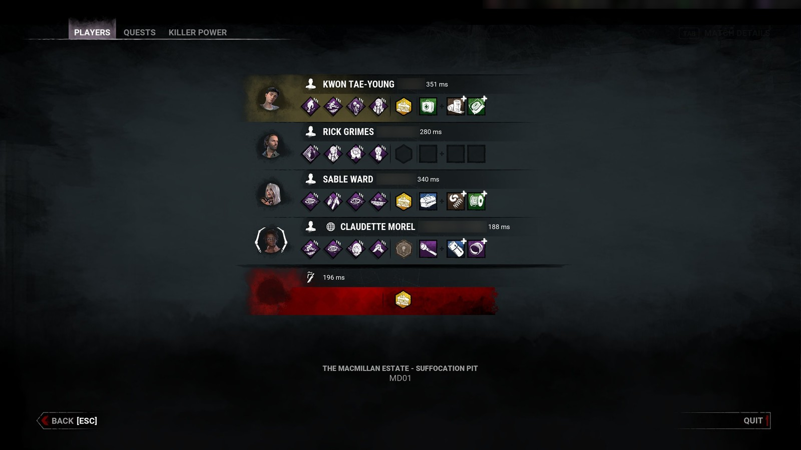
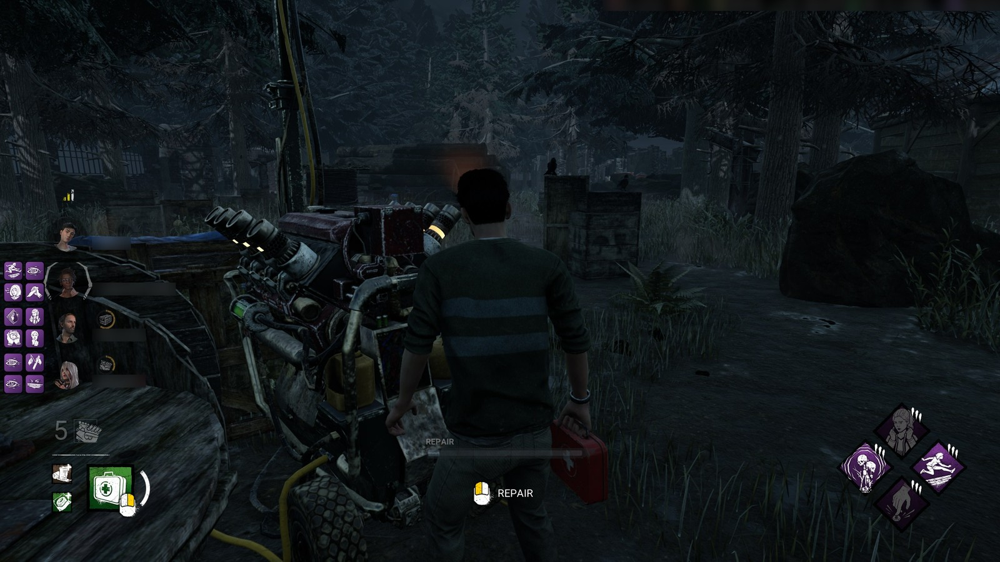
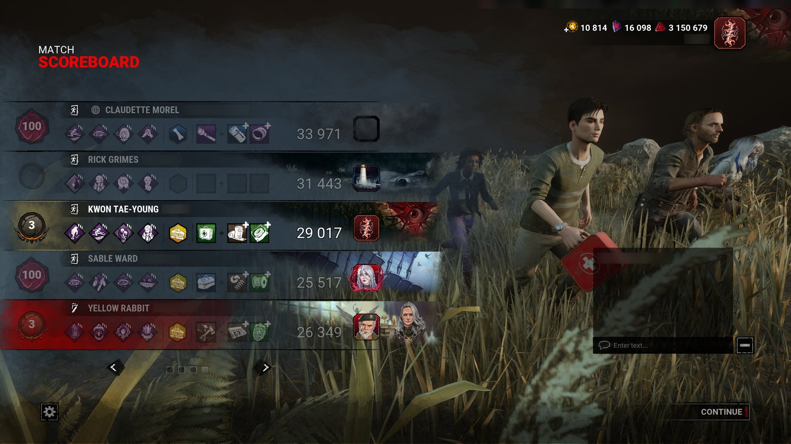
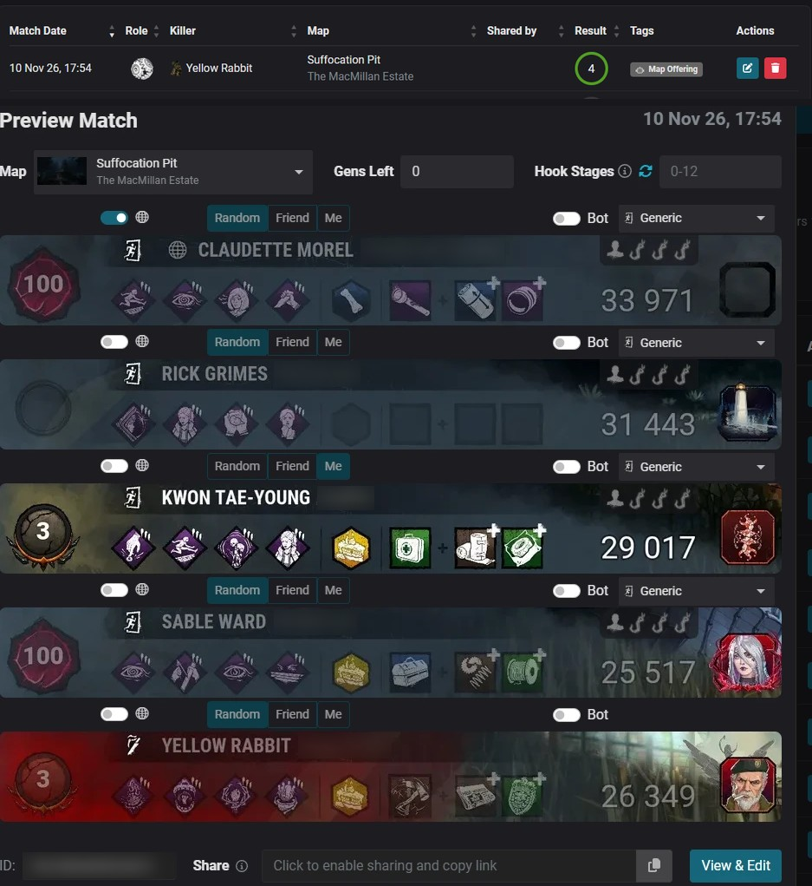

[← Accueil](https://github.com/Tau-hub/entity-toolkit/wiki/Accueil) · [English](https://github.com/Tau-hub/entity-toolkit/wiki/In-a-match)

## Comment ça marche, pas à pas

L'outil agit à **deux moments** d'une partie : au début, sur le menu des joueurs (Tab), et à la fin, sur le tableau de fin. Tu choisis dans **Settings** comment ces deux moments se déclenchent :

| Mode | Au début | À la fin |
|---|---|---|
| **Automatic** (par défaut) | Ouvre le menu des joueurs (Tab) et garde-le ouvert environ une seconde | Rien : le tableau part tout seul |
| **Hotkey** | Ouvre le menu des joueurs (Tab) et appuie sur **ta touche de capture** | Appuie sur **ta touche de capture** sur le tableau de fin |

**Ta touche de capture** est celle réglée dans Settings. C'est **Alt + pavé numérique 7** tant que tu ne la changes pas (verrouillage numérique activé), et n'importe quelle combinaison convient : `f9`, `ctrl+shift+n`… La seconde touche, celle qui **retire l'overlay** (Alt + pavé numérique 8 tant que tu ne la changes pas), efface les perks affichées.

**1. Au début : le menu des joueurs est lu.** L'outil prend une capture du jeu, lit le nom de la map en bas, puis pour chaque allié le personnage, le pseudo et les quatre perks (icônes comparées à celles téléchargées). Un petit son « ok » te dit que ça a marché ; le résultat s'affiche aussi sur la page **Live**.

- *Automatic :* ouvre le menu avec Tab et garde-le ouvert environ une seconde.
- *Hotkey :* ouvre le menu avec Tab et appuie sur ta touche de capture.

**2. Referme le menu : les perks apparaissent à côté de tes alliés.** La liste des survivants du jeu (en haut à gauche) n'est visible qu'une fois le menu fermé. L'outil la surveille, reconnaît chaque allié à son portrait (puis à son pseudo quand deux alliés jouent le même personnage) et dessine ses quatre perks en grille 2×2 à côté. Elles restent jusqu'à la fin de la partie. Pareil dans les deux modes.

**3. À la fin : le tableau de fin est lu.** L'overlay disparaît et la capture du tableau est lue : les joueurs, leurs perks, add-ons, offrandes, les points, et le badge de niveau de ton personnage (ton niveau est corrigé sur la page Levels).

- *Hotkey :* appuie sur ta touche de capture sur le tableau, une fois la partie terminée pour tout le monde (tant que les perks de certains joueurs sont cachées, la partie n'est pas finie et NightLight recevrait un tableau incomplet).
- *Automatic :* rien à faire. L'outil attend tout seul que les perks de tous les joueurs soient dévoilées.

**4. La partie est envoyée toute seule à NightLight** (si tu as configuré NightLight). Dès que l'image du tableau est bonne, un petit bip retentit et un message s'affiche en haut du jeu (*Sending the scoreboard to NightLight... you can leave it*) : **tu peux quitter le tableau tout de suite**, la suite travaille sur l'image déjà prise, et un dernier message t'annonce quand la partie est confirmée. Avec la map lue à l'étape 1, « Me » coché sur ton nom, tous les autres en Random, et confirmée, sans aucun clic de ta part. La partie apparaît ensuite dans ton historique NightLight comme n'importe quel envoi. Pareil dans les deux modes.

Si tu ne veux pas envoyer une partie, appuie sur ta touche qui retire l'overlay avant le tableau (elle retire l'overlay et oublie les perks), ou active *Dry run* dans Settings. Sans jeton NightLight, rien n'est jamais envoyé.

## Mode Hotkey

Choisis **Hotkey** dans Settings → *Hotkey or automatic* si tu préfères décider toi-même quand l'outil lit l'écran : il ne regarde alors rien tant que tu n'appuies pas sur ta touche de capture. Ta touche de capture ne réagit que si le jeu est lancé **et** au premier plan. Ce qu'elle fait dépend de l'écran :

| Tu es sur… | Ta touche de capture fait ceci |
|---|---|
| Le **menu des joueurs** (Tab), en survivant | Map mémorisée, perks des alliés sur la page Live, overlay dessiné quand tu refermes le menu |
| Le **menu des joueurs**, en tueur | Map mémorisée |
| Le jeu (menu fermé), overlay affiché | Rien ne change : l'overlay reste (seuls le tableau de fin ou ta touche qui retire l'overlay l'enlèvent) |
| Le jeu (menu fermé), overlay retiré | Overlay remis avec les dernières perks lues |
| Le **tableau de fin** | Overlay retiré, capture envoyée à NightLight, match revu et validé, niveau de ton personnage corrigé |
| Tout autre écran | Son « pas ok », rien n'est envoyé |

Les deux touches se changent dans Settings → *Hotkey or automatic* ; un nouveau raccourci prend effet au prochain démarrage de l'outil.

## Mode automatique

C'est le mode dans lequel l'outil démarre (Settings → *Hotkey or automatic* ; un changement s'applique en quelques secondes, sans redémarrage). Tu n'appuies sur aucune touche :

1. **Au début du match, appuie sur Tab et garde le menu ouvert environ une seconde.** L'outil voit le menu des joueurs, lit les perks et la map, et affiche l'overlay. Un appui de moins d'une demi-seconde peut passer inaperçu : il ne se passe alors rien, refais simplement Tab un peu plus longtemps.
2. **Joue.** Rouvrir Tab ne change rien : l'outil voit les mêmes alliés et garde les perks déjà affichées.
3. **À la fin, reste deux secondes sur le tableau de fin.** Le tableau part sur NightLight, et l'overlay est retiré, seulement quand le match est terminé pour tout le monde : le jeu dévoile alors les perks de chaque joueur, et l'outil attend que les quatre survivants et le tueur affichent les leurs. Si tu meurs en premier, ou si tu reviens du mode spectateur, le tableau que tu vois cache encore des perks : l'outil attend.

Ta touche de capture et ta touche qui retire l'overlay continuent de marcher en mode automatique, par exemple pour envoyer un tableau avant que tout le monde ait fini.

**Il ne fait que ce que tu as configuré.** Si NightLight n'est pas utilisé (pas de jeton, ou envoi désactivé dans Settings), la fin du match n'envoie rien et ne fait aucun son : l'outil retire seulement l'overlay et met ton niveau à jour.

**Si la première lecture est incomplète** (la souris était sur un objet ou une perk, donc l'infobulle du jeu cachait un allié ou une perk), l'outil se sert des captures supplémentaires qu'il prend juste après la première (jusqu'à six en deux secondes, la première après 0,15 s) et assemble les lectures, allié par allié et perk par perk. Si ça ne suffit toujours pas, il relit le menu à ton prochain Tab. C'est pareil en mode Hotkey.

**Ce que ça coûte.** Tant que le jeu est la fenêtre au premier plan, l'outil regarde une fine bande en haut à gauche de l'écran (là où sont écrits *PLAYERS* et *MATCH SCOREBOARD*) toutes les 2 secondes, et neuf fois dans les 1,6 seconde qui suivent un appui sur Tab. Un coup d'œil prend environ 30 ms. Quand le jeu n'est pas au premier plan, il ne regarde rien.

**Ce que ça touche.** Rien de nouveau par rapport à la touche de capture : une capture de l'écran, l'état de la touche Tab, et la liste des programmes lancés pour savoir que le jeu est au premier plan. La mémoire et les fichiers du jeu ne sont jamais lus, et rien n'est envoyé au jeu. Comme toujours, aucune garantie vis-à-vis de l'anti-triche : voir le README.

**Limites.** Un tableau n'est envoyé que si les cinq lignes montrent leur équipement. Un bot, ou un joueur venu sans aucune perk, affiche quand même les contours vides de ses emplacements de perks et les carrés des add-ons, ce qui compte ; une ligne vide est un équipement que le jeu cache encore (la partie n'est pas finie). Un match personnalisé à moins de cinq joueurs ne part pas tout seul : utilise ta touche de capture. Après un tableau, le suivant ne part pas tout seul pendant 2 min 30 (pour que quitter la page puis y revenir ne l'envoie pas deux fois). Si tu quittes un match sans voir le tableau de fin, l'overlay reste jusqu'à ton prochain Tab ou ta touche qui retire l'overlay.

## Dans les deux modes

**Retirer l'overlay.** Ta touche qui retire l'overlay efface les perks affichées et les oublie (pratique si tu ne veux pas envoyer ce match).

**Lire une perk.** Tant que la souris est libre (accroché, mort, spectateur), survole une icône de l'overlay pour voir son texte ; sors de l'icône et il disparaît. L'outil ne lit que la position de la souris (aucun hook, rien n'est lu dans le jeu) : rien du tout quand l'overlay est caché, deux fois par seconde pendant que tu joues (le jeu cache et verrouille le curseur), et une vérification rapide (25 fois par seconde) seulement quand la souris est libre **et** près des icônes. En jeu normal, la souris est verrouillée sur la caméra, donc rien ne s'affiche. `data/entity_toolkit.log` le consigne : des lignes `Overlay hover:` à chaque changement (souris verrouillée / libre, texte affiché / caché) et un résumé du nombre de vérifications chaque minute.

**Pourquoi l'overlay attend.** La liste des survivants du jeu n'est visible qu'une fois le menu Tab refermé. Après la lecture du menu, l'outil surveille l'écran, lit les noms de la liste du jeu et associe chaque allié à la bonne ligne, d'abord par le **portrait**, puis par le **pseudo** quand deux alliés jouent le même personnage ou que les portraits se ressemblent trop. Ta propre ligne ne bouge jamais.

**Démarrage et arrêt.** L'outil s'arrête tout seul quand le jeu se ferme. Pour qu'il démarre tout seul avec le jeu, coche *Start automatically with Windows* dans Settings (ou lance `python -m entity_toolkit autostart install`, annulé par `autostart remove`). Une seule copie tourne à la fois : si tu le lances à la main et que le démarrage automatique le relance ensuite avec le jeu, la seconde copie s'arrête d'elle-même, donc rien n'est traité deux fois.
