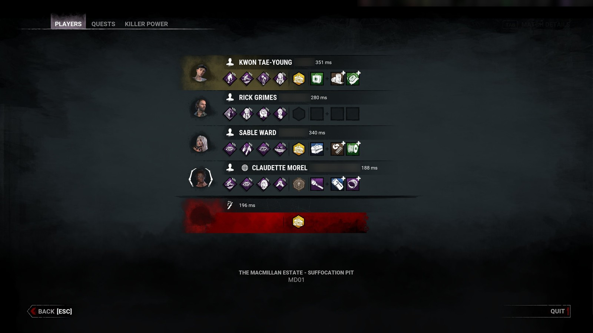
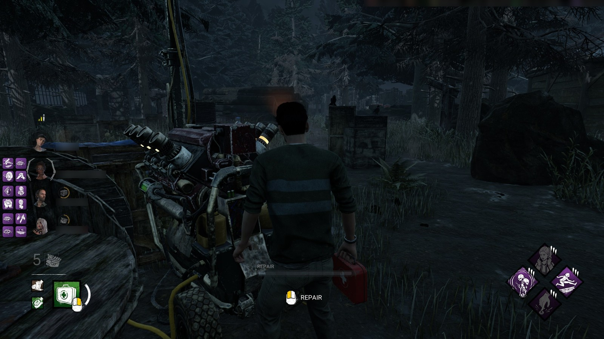
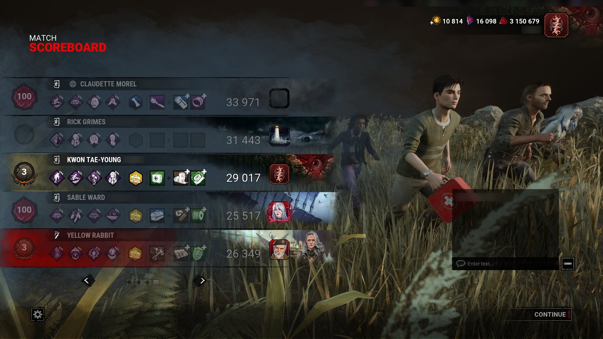
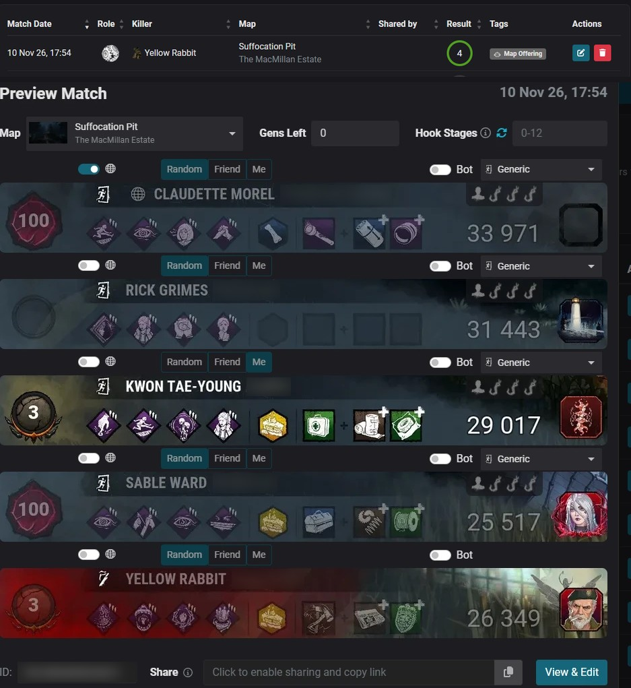

[← Home](https://github.com/Tau-hub/entity-toolkit/wiki/Home) · [Français](https://github.com/Tau-hub/entity-toolkit/wiki/En-match)

## How it works, step by step

One key, **Alt + Numpad 7** (NumLock on), at three moments of a match. Everything else is automatic.

**1. In the Tab menu: press the key.** The toolkit takes a screenshot of the game, reads the map name at the bottom, then for each ally the character, the player name and the four perks (icons compared with the downloaded ones). A short "ok" sound tells you it worked; the result also shows on the **Live** page.

**2. Close the menu: the perks appear next to your allies.** The game's own survivor list (top left of the screen) is only visible once the menu is closed. The toolkit watches it, recognises each ally by portrait (then by player name when two allies play the same character) and draws their four perks in a 2×2 grid beside them. You can press the key again at any time in the game: nothing changes, the overlay stays until the end of the match.

**3. At the end of the match, on the scoreboard: press the key again.** The overlay is removed and the scoreboard screenshot is read: the players, their perks, add-ons, offerings, the points, and your character's level badge (your level is corrected on the Levels page).

**4. The match is uploaded to NightLight by itself.** It is sent with the map read in step 1, "Me" ticked on your name, everyone else set to Random, and confirmed, with no click from you. The match then appears in your NightLight history like any other upload.

If you do not want a match uploaded, press **Alt + Numpad 8** before the scoreboard (it removes the overlay and forgets the perks), or turn on *Dry run* in the Settings.

## Using it during a match

The default key is **Alt + Numpad 7** (NumLock on). It only reacts while the game is running **and** in front.

| You are on… | Press the key | Result |
|---|---|---|
| The **players menu** (Tab), as survivor | once | Map remembered, allies' perks on the Live page, overlay drawn once you close the menu |
| The **players menu**, as killer | once | Map remembered |
| The game (menu closed), overlay shown | once | Overlay stays (it is only removed by the scoreboard or by Alt + Numpad 8) |
| The game (menu closed), overlay removed | once | Overlay put back with the last perks read |
| The **match scoreboard** | once | Overlay removed, screenshot sent to NightLight, match reviewed and confirmed, your character's level corrected |
| Anything else | once | "Not ok" sound, nothing is sent |

**Alt + Numpad 8** removes the overlay and forgets the perks (handy if you do not want to upload that match). Both keys can be changed on the Settings page.

The toolkit stops by itself when the game closes. To have it start by itself when the game starts: `python -m entity_toolkit autostart install` (undo with `autostart remove`). Only one copy ever runs: if you start it with `run.bat` and the autostart watcher then launches it again when the game starts, the second copy stops by itself, so a key press is handled once.

**Reading a perk:** while the mouse is free (hooked, dead, spectating), hover an icon of the overlay to see its text; move off the icon and it goes away. It only reads the mouse position (no hook, nothing read from the game): nothing at all while the overlay is hidden, twice a second while you play (the game hides and locks the cursor), and a fast check (25 times a second) only when the mouse is free **and** near the icons. During normal play the mouse is locked to the camera, so nothing shows. `data/entity_toolkit.log` records it: `Overlay hover:` lines for every change (mouse locked / free, text shown / hidden) and a summary of the number of checks each minute.

Why the overlay waits: the game's own survivor list is only visible once the Tab menu is closed. After the key press the toolkit watches the screen, reads the names in the game's list and matches each ally to the right row, first by **portrait**, then by **player name** when two allies play the same character or the portraits are too similar. Your own row never moves.

## Automatic mode

Settings → Options starts with a choice: **Hotkey** (the default: you press the capture key, which you can change just below) or **Automatic**. In automatic mode you no longer press the capture key:

1. **At the start of the match, press Tab** as you would anyway. The toolkit sees the players menu, reads the perks and the map, and draws the overlay.
2. **Play.** Opening Tab again changes nothing: the toolkit sees the same allies and keeps the perks already shown.
3. **At the end, stay on the scoreboard a couple of seconds.** The scoreboard is sent to NightLight, and the overlay removed, only when the match is over for everyone: the game then reveals every player's perks, and the toolkit waits until the four survivors and the killer all show theirs. If you die first, or come back from spectating, the scoreboard you see still hides some perks: the toolkit waits. Press the capture key if you want to send it right away.

The capture key and the clear key keep working exactly as before.

**It only does what you set up.** If NightLight is not in use (no token, or sending turned off in Settings), the end of the match sends nothing and makes no sound: the toolkit just removes the overlay and updates your level.

**What it costs.** While the game is the window in front, the toolkit looks at a thin strip at the top left of the screen (where *PLAYERS* and *MATCH SCOREBOARD* are written) every 2 seconds, and three times in the two seconds after a Tab press. One look takes about 30 ms. When the game is not in front, it looks at nothing.

**What it touches.** Nothing new compared with the capture key: a screenshot of the monitor, the state of the Tab key, and the list of running programs to know the game is in front. The game's memory and files are never read, and nothing is sent to the game. As always, there is no guarantee about anti-cheat: see the README.

**If the first reading is incomplete** (the mouse was on an item or a perk, so the game's own tooltip covered the allies), the toolkit uses the few extra screenshots it takes during the two seconds after the first one, and puts the readings together ally by ally; if that is still not enough, it reads the menu again at your next Tab. Keeping Tab open a second or two, with the mouse away from the icons, is enough.

**Limits.** A scoreboard is sent only when all five rows show at least one perk, so a custom match with fewer players, or a player who brought no perk at all, is not sent by itself: use the capture key. After one scoreboard, the next one is not sent by itself for 2.5 minutes (so leaving the page and coming back does not send it twice).
