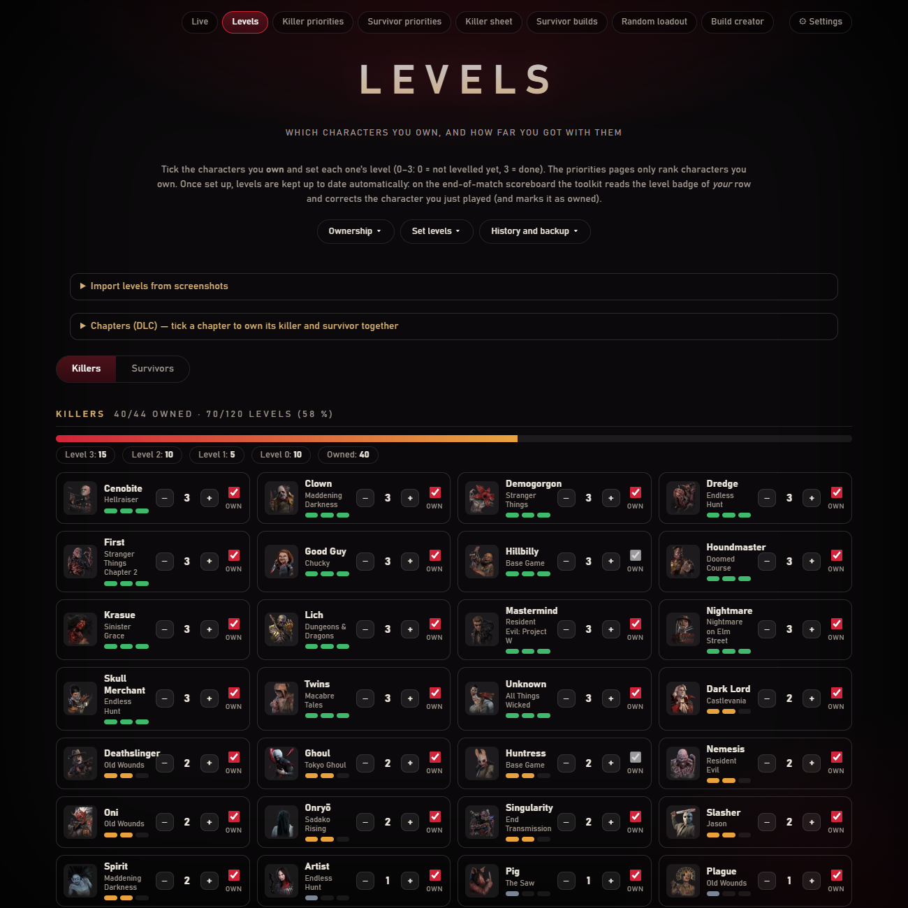
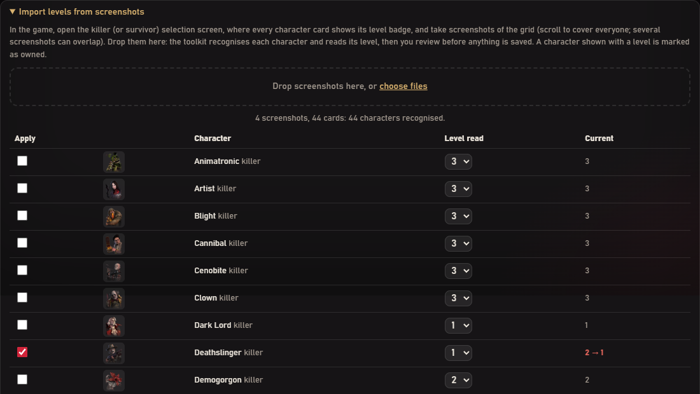
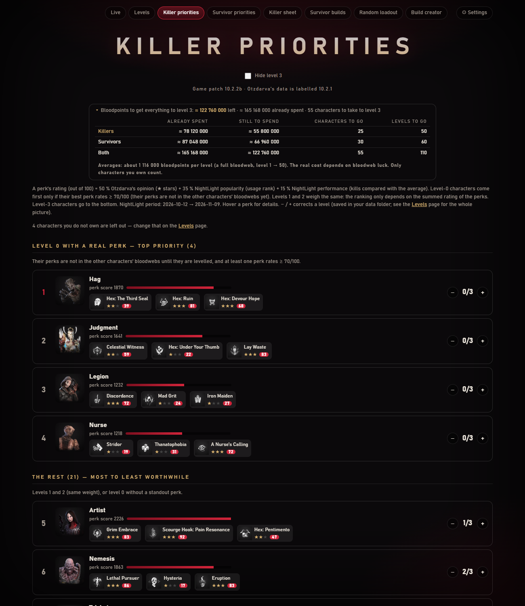

[← Home](https://github.com/Tau-hub/entity-toolkit/wiki/Home) · [Français](https://github.com/Tau-hub/entity-toolkit/wiki/Niveaux-et-priorites)

## Levels

*Dropping four screenshots of the killer selection screen: every character recognised, with the levels that differ from the saved ones ticked for you to apply.*

Levels run from 0 to 3 (0 = not levelled yet, 3 = done). A new user sets them once on the **Levels** page, either by hand or by **dropping screenshots of the in-game killer and survivor selection screens**: the toolkit recognises each character card (SIFT feature matching against the downloaded portraits) and reads its level badge, then shows what it found so you can review and apply it. By hand: **+** and **−** per character, and three drop-down menus on top: **Ownership**, **Set levels** (every owned killer or survivor to 0 or 3) and **History and backup** (changes, earlier states, **Import / Export JSON** to move your levels between PCs or share them, reset). After that the toolkit keeps them current by itself: on the scoreboard it reads the level badge of *your* row and corrects the character you just played. Not everybody owns every character, so each one also has an **Own** checkbox: **I own everything**, **I own only the base game** (then tick what you have), a **Chapters (DLC)** panel that toggles a killer and the survivor from the same chapter together, or one by one. The priorities only rank the characters you own, and playing a character on the scoreboard marks it as owned.

Bulk actions (own everything, set every level, reset, import) ask for confirmation and keep the previous state first: **Undo** right after, or *History and backup → Changes and earlier states → Restore* later (the last 20 states are kept in `data/levels_backups.json`).

## Priorities

The **Killer priorities** and **Survivor priorities** pages rank the characters you own by what their perks are worth (Otzdarva's opinion, NightLight popularity and performance), with Level-0 characters that bring a standout perk first. A collapsed line at the top gives the bloodpoints already spent and still to spend to bring everything to level 3, for killers, survivors and both, and how many characters and levels that is. It is an **estimate** (about 1,116,000 bloodpoints per level, a full bloodweb): the real cost depends on the bloodweb's luck.

**Shrine of Secrets.** At the top of both pages, a panel shows the four perks of this week's Shrine, with their rating and, for each one, whether you already have it (its character is levelled on the Levels page) or not. A perk you do not have that rates 60/100 or more is highlighted as worth your shards, and a dot appears on the priorities button until you have opened the page. The list comes from NightLight's public data, read once when the week changes; turn it off in Settings.
