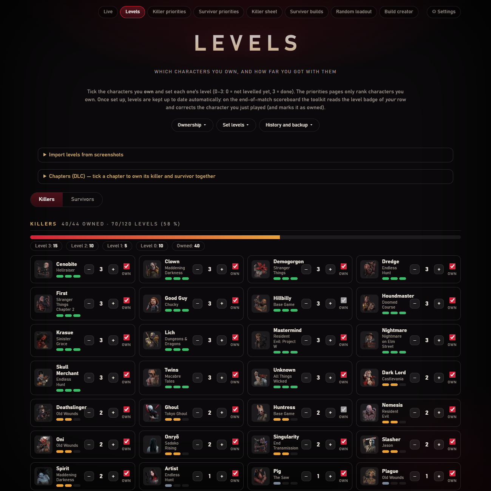
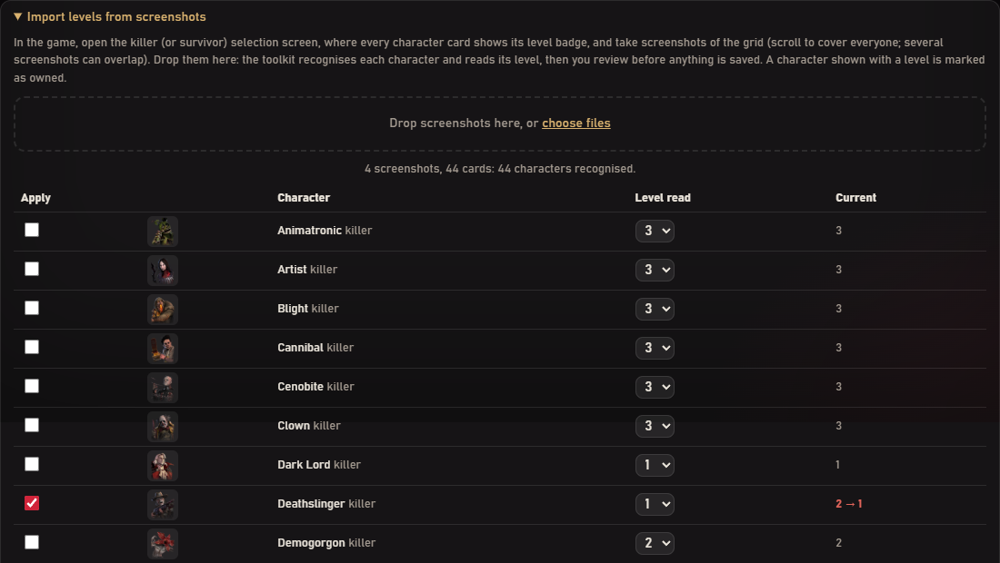
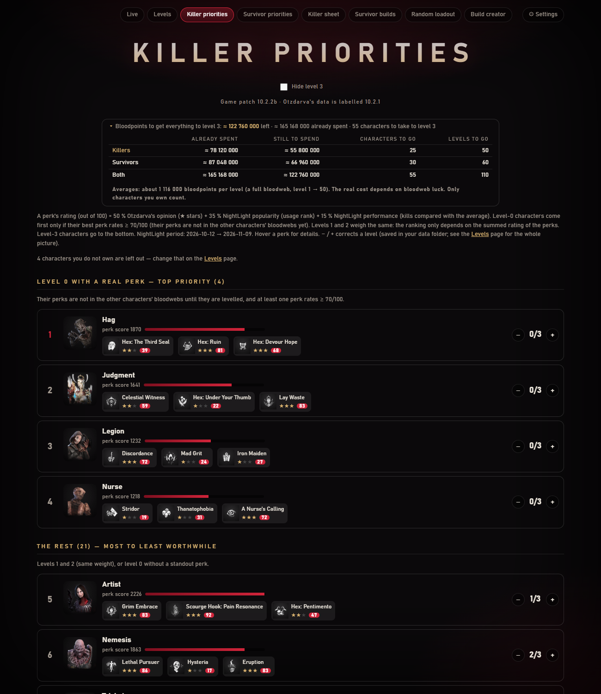

[← Accueil](https://github.com/Tau-hub/entity-toolkit/wiki/Accueil) · [English](https://github.com/Tau-hub/entity-toolkit/wiki/Levels-and-priorities)

## Niveaux

*Dépôt de quatre captures de l'écran de sélection des tueurs : chaque personnage est reconnu, et les niveaux qui diffèrent de ceux enregistrés sont cochés pour que tu les appliques.*

Les niveaux vont de 0 à 3 (0 = pas encore monté, 3 = terminé). Un nouvel utilisateur les règle une fois sur la page **Levels**, soit à la main, soit en **déposant des captures des écrans de sélection des tueurs et des survivants** : l'outil reconnaît chaque carte de personnage (correspondance de points d'intérêt SIFT avec les portraits téléchargés) et lit sa pastille de niveau, puis te montre ce qu'il a trouvé pour que tu vérifies et appliques. À la main : **+** et **−** par personnage, et trois menus déroulants en haut : **Ownership**, **Set levels** (tous les tueurs ou survivants possédés à 0 ou à 3) et **History and backup** (changements, états précédents, **Import / Export JSON** pour déplacer tes niveaux d'un PC à l'autre ou les partager, réinitialisation). Ensuite l'outil les tient à jour tout seul : sur le tableau de fin, il lit la pastille de niveau de *ta* ligne et corrige le personnage que tu viens de jouer. Tout le monde ne possède pas tous les personnages : chacun a donc une case **Own**. Boutons **I own everything** et **I own only the base game** (puis tu coches ce que tu as), panneau **Chapters (DLC)** qui coche ensemble le tueur et le survivant d'un même chapitre, ou un par un. Les priorités ne classent que les personnages que tu possèdes, et jouer un personnage sur le tableau de fin le marque comme possédé.

Les actions en masse (tout posséder, régler tous les niveaux, réinitialiser, importer) demandent confirmation et gardent d'abord l'état précédent : **Undo** juste après, ou *History and backup → Changes and earlier states → Restore* plus tard (les 20 derniers états sont gardés dans `data/levels_backups.json`).

## Priorités

Les pages **Killer priorities** et **Survivor priorities** classent les personnages que tu possèdes selon la valeur de leurs perks (avis d'Otzdarva, popularité et performance NightLight), avec en premier les personnages de niveau 0 qui apportent une perk de premier plan. Une ligne repliée en haut donne les points de sang déjà dépensés et ceux qui restent pour tout amener au niveau 3, pour les tueurs, les survivants et les deux, avec le nombre de personnages et de niveaux concernés. C'est une **estimation** (environ 1 116 000 points de sang par niveau, une bloodweb complète) : le vrai coût dépend de la chance dans la bloodweb.

**Shrine of Secrets.** En haut des deux pages, un encadré montre les quatre perks du Shrine de la semaine, avec leur note et, pour chacune, si tu l'as déjà (son personnage est monté sur la page Levels) ou non. Une perk que tu n'as pas et notée 60/100 ou plus est mise en avant comme valant tes éclats, et un point apparaît sur le bouton des priorités tant que tu n'as pas ouvert la page. La liste vient des données publiques de NightLight, lues une fois au changement de semaine ; désactivable dans Settings.
