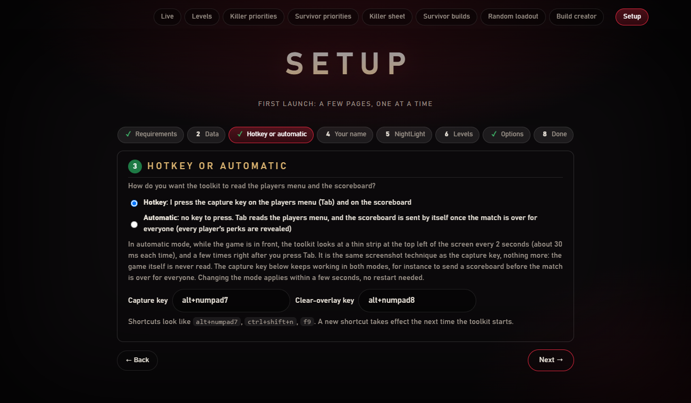
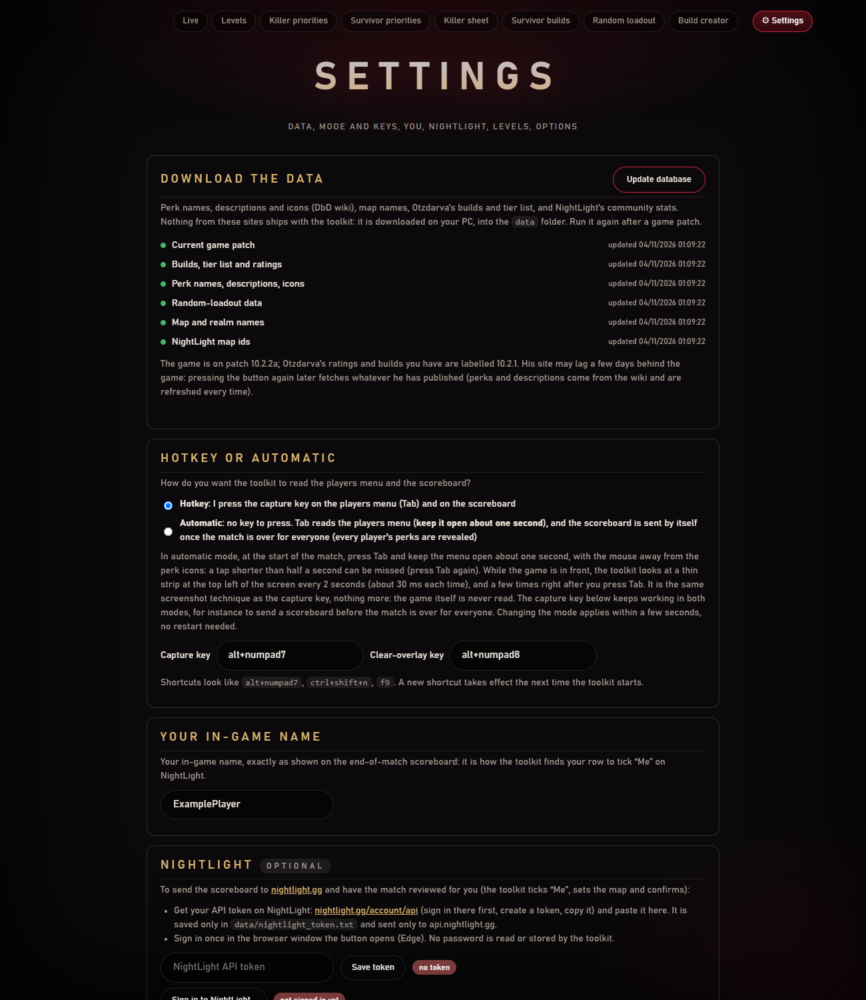

[← Home](https://github.com/Tau-hub/entity-toolkit/wiki/Home) · [Français](https://github.com/Tau-hub/entity-toolkit/wiki/Configuration)

## First launch: the Setup page

On the first launch, the Setup goes **one page at a time**, with **Next** and **Back**. Nothing blocks you: you can skip a page and come back, and everything is found again later in **⚙ Settings**.

1. **Requirements.** The page checks that Windows has an English OCR engine.
2. **Update database.** One button downloads perk names, descriptions and icons (DbD wiki), map names, Otzdarva's builds and tier list, and NightLight's stats. The first time takes a few minutes. Run it again after a game patch (new perks, new maps, new ratings). The page shows the patch the game is on (from the Steam announcements) and the patch label of Otzdarva's data, which can lag a few days behind the game; wiki pages are re-downloaded on every update. Each step reports on its own, so one site being down does not block the others. The same thing from a console: `python -m entity_toolkit update-db`. While it runs, the page shows which step it is on, and afterwards what the patch brought (new or removed killers, survivors, perks, add-ons, items, offerings, maps). Once you have done it once, the toolkit refreshes the data by itself every 7 days in the background (change or turn off in *Options*). Press the button, then **Next**: the download goes on in the background while you fill in the rest (and **Next** starts it for you if you forgot).
3. **Hotkey or automatic.** Choose how the toolkit is triggered: in automatic mode (the default), where you only keep the Tab menu open about one second at the start of the match, or with a capture key of your choice (Alt + Numpad 7 until you change it; the clear key is set here too) (see [In a match](https://github.com/Tau-hub/entity-toolkit/wiki/In-a-match#automatic-mode)).
4. **Your in-game name.** Type your in-game name exactly as the scoreboard shows it.
5. **NightLight** (optional). The link on the page goes to [nightlight.gg/account/api](https://nightlight.gg/account/api), where you create your API token; paste it, then sign in once in the Edge window the button opens. The toolkit never sees your password. You do not use NightLight? Press **Next**: without a token nothing is ever sent, even in automatic mode.
6. **Your character levels** (optional). Drop screenshots of the in-game killer and survivor selection screens right on the Setup page and the toolkit reads which characters you have and their levels (you review before saving), or set them by hand on the **Levels** page (see below).
7. **Options.** The defaults suit most players. Overlay on/off, sounds, the notification-area icon, the new-version check, the Entity Toolkit window or your browser, opening it on the Live page when the toolkit starts (on by default: with the automatic start, it opens each time you launch the game), what closing the window does, dry run (saves the scoreboard but never sends it), the Shrine of Secrets panel, starting with Windows, and how often the database refreshes by itself.
8. **Done.** A summary of what is ready and what you skipped, then **Finish setup**, which opens the Live page.

Every change on the page is saved as soon as you make it (a small *Saved ✓* note appears at the bottom right): there is no save button.

Once you press **Finish setup**, the *Setup* button becomes **⚙ Settings** (top right): the same content on one page, without the requirements: update the database, choose hotkey or automatic and your keys, change your name, set the NightLight token, import levels, and the options. *Reset the setup* at the bottom brings the page-by-page setup back (your data is kept).

### The Entity Toolkit window

The pages are shown in a window of their own, like any program: no web browser and no address to type. You can move it, resize it, minimise it and maximise it.

- **Where it opens.** The first time, in the middle of the screen at 75 % of its size, on your second screen if you have one (so that it does not cover the game). After that it reopens where you left it, at the size you gave it.
- **Closing it.** The first time, it asks: **Keep it running** (the window goes away, the toolkit keeps reading your matches from the notification area) or **Quit Entity Toolkit** (everything stops). Tick *Remember my choice* and it no longer asks; the choice is in the options (*When I close the window*).
- **Getting it back.** Double-click the red **E** in the notification area, or start the program again: the copy already running shows its window.
- **With the game.** With *Start automatically with Windows*, the window opens by itself on the Live page when you launch Dead by Daylight. The toolkit stops when the game **and** the window are both closed.
- **Prefer your browser?** Untick *Show the pages in the Entity Toolkit window* in the options: the pages then open in your default browser, as before.

Under the hood nothing changed: the window shows the same local pages, served by the toolkit on your PC only, with the web engine built into Windows (WebView2, the one Edge uses). If that engine is missing, the toolkit falls back to your browser by itself.

### The notification-area icon

While the toolkit runs, a small red **E** sits in the Windows notification area (bottom right of the taskbar, behind the **^** arrow if Windows hides it). It tells you the toolkit is on, and it is the way back to the window once you have closed it:

- **Double-click**: opens the Live page.
- **Right-click**: a menu with every page (Live, Levels, Killer priorities, Survivor priorities, Killer sheet, Survivor builds, Random loadout, Build creator), today's two daily challenges, **Settings**, then **Quit Entity Toolkit**, which stops the toolkit: the capture key or the automatic mode, the overlay and the local pages.

You can turn the icon off in the options; the toolkit works the same without it.
